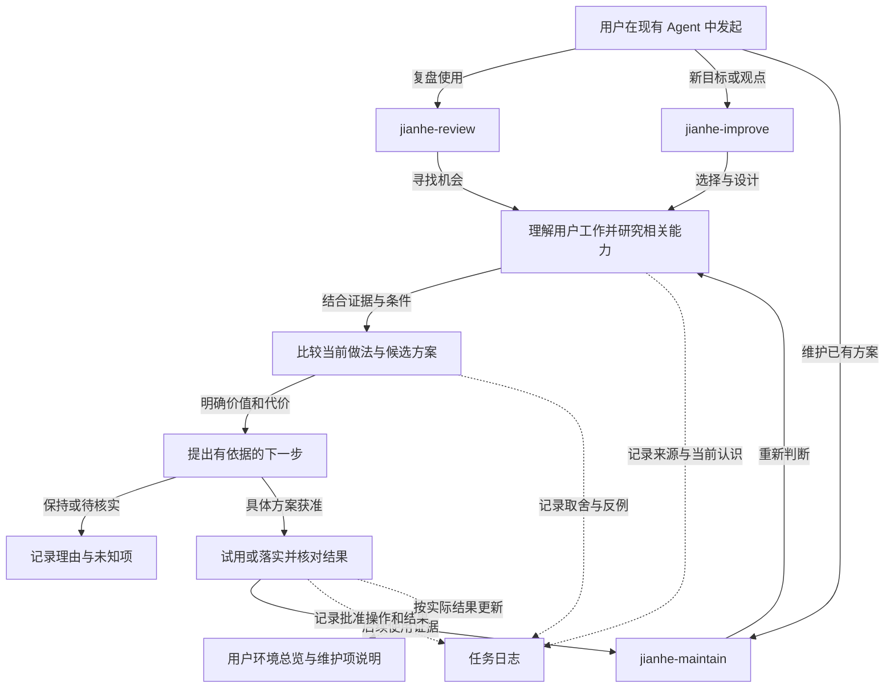

# Jianhe

让 AI 与你的工作越用越合拍。

**v0.0.3 · 测试版（Pre-release）**。用于首次真实安装、体验与问题反馈，不是稳定版，也不表示已经可以完整替代现有 Harness。

[下载 Skill 安装包](https://github.com/zzf2333/Jianhe/releases/download/v0.0.3/jianhe-v0.0.3.zip) · [发布说明与 SHA256SUMS](https://github.com/zzf2333/Jianhe/releases/tag/v0.0.3) · [反馈问题](https://github.com/zzf2333/Jianhe/issues)

Jianhe（渐合）是一组帮助用户持续审查和改善 **AI 工作环境与使用方式** 的 Skills。它结合用户的目标、习惯、实际使用记录和工具能力，主动研究更合适的做法，设计并落实单工具或多 Agent 协作方案，再根据后续使用持续调整。

用户不必先熟悉所有工具文档，也不必先知道问题在哪里。我们的工作包括发现尚未利用的能力、减少重复操作与维护负担、改进工具之间的交接，并保留真正有效的经验。判断标准是工作是否更顺畅、结果是否更可靠，以及增加的成本是否值得；“越用越好”需要持续观察，不能预先承诺。

**第一版交付三个 Skill，优化范围是用户的整套 AI 环境。** 它们依靠当前宿主已有的读取、搜索、文档查询、编辑和执行能力工作，不需要项目 CLI 或额外服务。经具体批准，方案可以包含第三方工具的安装、配置和组合；这不表示本项目要开发一套编排平台。

## 三个入口

| Skill | 什么时候用 | 帮你得到什么 |
|---|---|---|
| [jianhe-review](skill/jianhe-review/SKILL.md) | 已有使用记录，或“看看还能怎样优化” | 理解当前工作、主动研究相关能力，发现用户尚未指出的机会与成功经验；研究到能解释机会为什么值得考虑 |
| [jianhe-improve](skill/jianhe-improve/SKILL.md) | 新目标、观点、文章或发现的机会 | 比较做法并设计单工具或多工具方案；研究到足以选择和落实，按批准试用、配置或安装 |
| [jianhe-maintain](skill/jianhe-maintain/SKILL.md) | 已经采用的方案，或环境与需求变化 | 用后续证据重新判断整套方案，主动研究新能力和更简单的替代，决定保留、调整、精简、替换或退出 |

三个入口可以单独使用，也可以配合。用户无需连续调用三次，不必重复提供同一份背景。尚未安装其他入口时，每个 Skill 仍能独立完成自己的工作。

## 怎样发现、研究和判断

三个入口共用一套方法，按本次决定选择深度，不要求每次重复调查全部环境：

1. **理解用户怎样完成工作。** 看目标、实际步骤、工具分工、上下文与结果交接、验收和用户介入。区分明确偏好、观察到的习惯和受工具限制产生的迁就；反复手工操作不代表用户喜欢这样做。
2. **核对相关工具能力。** 从所需能力提出问题，主动查现有工具和相关第三方文档与实践。分清工具宣称支持、当前版本支持、本地可用和用户实际使用；不只搜索已知产品名，也不只在出错时研究。
3. **比较可能的做法。** 将维持现状、用好已有功能、调整配置、重组工具和引入工具作为候选，比较对工作结果、学习、费用和维护负担的影响。寻找问题，也寻找可推广的成功经验。
4. **形成可核查的决定。** 把实际观察、能力依据、改变哪一步、为何适合用户、代价与反例、验证方法串起来。能解释机会或选定下一步就结束本轮研究；影响执行的前提未核实时，先给核实办法，不把候选说成已可实施。

官方文档说明支持条件，本地核对说明当前可用性，社区案例提供候选思路，它们都不能直接证明对这位用户有效。关键来源记录版本、核对日期和适用条件，资料不可获取时标明未知，不凭记忆填补。外部检索不上传私人会话、配置或凭证。

当前工作与能力认识保存在任务日志中，后续复用并按目标、环境变化更新，不另建用户画像或知识库。跨 Skill 衔接传递已有依据，不让用户重复说明背景。

## 怎样配合

下图为设计示意：实线表示工作衔接，虚线表示记录关系。三个入口都能理解、研究与比较；这些共同步骤不是第四个 Skill。用户可从任意入口开始，按目标决定研究深度。



方案可以优化指令、Skills、MCP、Hooks、扩展与工具配置，也可以改变任务描述、上下文提供、任务拆分和协作节奏。多工具方案需要说明谁理解需求、谁执行、谁验证，输入输出怎样交接，用户在哪些环节控制，以及怎样试用和退出。单点改动不必强套整张流程表。

多 Agent 派遣、Skill 单份维护与按项目启用都是可能的方案类型，不是默认答案。具体兼容性、链接方式和加载规则需要按环境查证；不固定某个品牌必须担任主控，也不把共享文件或减少全局启用直接等同于兼容或节省 Token。

## 安装与首次使用

1. 从上方 Release 下载 `jianhe-v0.0.3.zip` 并解压；包内 `VERSION` 与各 `SKILL.md` 的 `metadata.version` 都应为 `0.0.3`。
2. 将 `skill/` 内三个完整目录安装到主要使用的 Agent 的技能目录，按宿主要求重载或重开会话。只想使用其中一个入口也可以。
3. 在日常工作目录开启新会话，不在本项目源码目录运行，也不带开发讨论或预置结论。直接提出真实需求。

把 `skill/` 内需要的完整目录复制到宿主支持的 Skill 目录，然后按宿主方式重载或重开会话。每个目录包含自己的 `SKILL.md` 和按需附带的参考文档，没有跨 Skill 的文件依赖。`jianhe-review/references/session-reading.md` 随 review 一起复制，不能只复制入口文件。

常见位置：

| 宿主 | Skill 目录 |
|---|---|
| Claude Code | `~/.claude/skills/` |
| Pi | `~/.pi/agent/skills/` |
| Codex | `~/.agents/skills/` |

这里的 `~` 表示用户目录；Windows 原生环境按实际 `%USERPROFILE%`（PowerShell 为 `$env:USERPROFILE`）解析，WSL 使用其自己的 HOME。以上是常见用户级位置，安装路径应按实际宿主文档核对，Windows 实机发现与写入尚未验证。

也可使用宿主提供的项目级技能目录或自定义搜索路径。将三个目录分别放进去，不要只复制最外层 `skill/`。安装路径以所用宿主的实际配置为准。

安装后，用自然语言点名要使用的 Skill。请确认宿主实际读到的是新目录中的 `SKILL.md`，其版本为 `0.0.3`；若已有同名目录或旧链接，先核对来源，保留自己的修改，避免重复安装造成遮蔽。是否自动发现或选用取决于宿主，本项目不接管宿主设置。

第一次可以直接说：

> 第一次使用 Jianhe。请用 jianhe-improve 了解我的 AI 工作方式，建立必要的环境说明，给出下一步建议，先不修改工具配置。

没有独立初始化 Skill 或项目启动命令。用户日志与目录由宿主按需创建；没有旧总览或历史就明确说明，从本次目标开始，不能要求用户先准备全部资料。保留现有 Agent 和工具环境，不预先导入 temper 账本或运行其提取器；已有用户记录也不要为试用擅自清空。

## 更新与反馈

项目自 `v0.0.2` 起由 Harness Grove 更名为 Jianhe。从 `v0.0.3` 起，三个入口统一为 `jianhe-review`、`jianhe-improve`、`jianhe-maintain`，默认用户数据目录为 `.jianhe/`，替代上一版保留旧入口和目录的安排。旧测试版使用者应按新名称安装并停用旧入口；需要接续旧记录时可显式指定原数据目录。本版本不提供旧入口别名或自动迁移，已发布版本的标签、附件和历史说明保留原样。

后续测试版使用 `v0.0.4`、`v0.0.5` 等版本，每次从对应 Release 下载完整目录，按宿主方式替换本产品的已安装副本并重载。先保留自己改过的 Skill 内容，不覆盖其他技能；更新 Skill 不等于清空 `.jianhe/` 的日志、维护项或备份，也不自动迁移这些数据。回到旧 Skill 版本不等于撤销它已对用户环境实施的改动，恢复仍按原事项处理。

正常使用后在 [GitHub Issues](https://github.com/zzf2333/Jianhe/issues) 描述遇到的问题即可。尽量提供：产品版本、操作系统与宿主版本、使用的 Skill、当时的请求、预期和实际结果、最短可复现步骤。能提供证据时只附必要的脱敏片段；不要上传完整私人会话、配置、备份、凭证或整份原生轨迹。

维护流程是 issue → 复现与限定修复 → PR 审查与验证 → 合并 → 新测试版。已发布的版本和标签不覆盖，修复用新版本；重大范围或权限变化另行确认。真实首次使用、核心分析/维护/落地流程和记录接续经过反馈修正、没有阻塞使用的问题，并由维护者确认稳定后，再发布 `v0.1.0`。不把合成样例通过或暂时没人报错当作稳定证明。

## 使用例子

**定期分析：**

> 用 jianhe-review 分析上次到现在的使用，了解我怎样完成任务，研究相关工具能力，看看有哪些我还没想到的改进机会。先给依据和建议，不改环境。

首次使用没有截止记录时，Agent 会明确起始范围。记录不可获取或没有读完时，它应说明缺口，不把部分分析当全部完成。

**维护已有优化：**

> 用 jianhe-maintain 看看之前采用的工具分工和优化方案是否还适合现在的任务。结合后续表现和工具变化，判断哪些值得保留、简化或替换。

维护会回看原来的理由和后续表现。最近没触发不等于可以删，效果不明时可以继续观察。

**应用新观点：**

> 用 jianhe-improve 分析这个想法是否适合我，查证相关工具能力，比较已有功能和其他做法，设计一套实际能用的流程，让我确认后再实施。

也可以提供自己的想法，或说明一个新任务。没有历史记录也可以开始，不需要先全量盘点或接管配置。

## 读取记录与找回未完成事项

`jianhe-review` 随附 [跨 Agent 记录读取指导](skill/jianhe-review/references/session-reading.md)：先核对 Pi、Codex、Claude Code 的实际版本和存储位置，再按记录结构区分用户交互、子代理、自动任务、演练及性质未知的材料。文档给出候选入口和核对依据，不承诺所有版本格式稳定，也不调用新的模型会话来重建历史。

读取进度按来源记录会话、文件位置和可用事件 ID，时间不是唯一断点。同时间戳的新记录不能漏掉；分叉继承与重复导出不能重复计数，分叉后的独立执行保留。分批读取、未获取与未完成都要有覆盖说明，不把抽样当全量完成。

每个建议或观点在首次任务日志中用独立标题 `### P1` 等定位，后续任务通过原日志的 `#p1` 链接接续，不因换会话重新编号。任务日志收尾的“待跟进”部分记录当前情况、原因、重评条件或下一步、最近相关日志。例如暂缓、待决定、待观察、待完成或已结束；“已结束”须有理由，不等于证明有效。

用户根目录 `README.md` 的“待跟进”一节只提供导航：原事项链接、一句现状、触发条件和最近日志。开始任务时确定记录位置，按批查相关导航和后续记录并及时记入 Markdown，再作出接续判断；索引缺失或滞后时，按相关时间、来源、任务范围分批补查日志收尾，不默认读全部历史，也不把索引没有当作事项不存在。

判断以原依据和后续明确决定、实际结果为准，不只看索引或文件修改时间。每次结束更新对应导航，原日志保留。用户明确限制仅写日志时不更新索引，在日志中注明未同步；下次补查这些记录。这个机制不需要数据库、专用账本或另一套任务系统。

## 指标与后续观察

只记录与原事项目标和当前决定有关的指标。review 建立当前观察基线，improve 在试用前写清原口径、预期方向与观察条件，maintain 回读这些依据再比较后续表现。记录直接放在原事项及后续任务日志中，不新增指标目录、数据库或仪表盘。

指标要让下一次能照同一含义理解：统计的是任务、请求还是尝试；数据来自哪里；窗口、时区、实际覆盖和缺失是什么；单位、算法或聚合方式是否一致；模型、任务类型等条件有没有变化。比例显示分子和有效观察机会分母 `n/N`。偏好与清理可以定性核对，不强行打分；没有基线也可以提出试用，但不能补造改前数值。

以下仅为说明口径的虚构数字：

| 基线与后续 | 能说什么 | 不能说什么 |
|---|---|---|
| 失败 `3/20 → 2/5` | 次数减少，观察失败率却从15%升至40% | 仅凭失败次数减少就说改善，或直接认定优化导致恶化 |
| 后续 `0/0`，确认没有相关任务 | 没有观察机会，比例不适用、效果未知 | 失败率0%，所以有效 |
| 同口径 `4/20 → 1/20` | 观察率从20%降至5%，下降15个百分点 | 把15个百分点写成相对下降15%，或据此证明因果收益 |

完整观察、确认无机会和数据缺失分开。只拿到一部分记录时，可以报告已观察样本，但注明缺口，不能当全量；分母未知不算比例，缺失数据不补零。

先检查可比性：定义、单位或统计对象不同，能从已有数据对齐才比较，否则并列展示；模型、任务构成等条件变化但定义相同时，可以描述观察值变化，并明确比较限制。使用可比子集要说明选择理由和排除范围，保留原结果，不为得到好结论挑样本。不同条目的样本关系未提供时，分别解释各自结果，不推断包含关系或合并统计。实际采用的计算与附加解释要用原始值复核，不写无助于当前决定的推算。

费用、Token、耗时只在与目标有关时核对。账单、价格估算、余额变化各自标明来源，币种与计费范围不同不直接合计；没有计费依据不能从Token算实付。累计值、增量值和缓存包含关系先确认，主子任务重复记录不重复相加；并行调用耗时之和不是用户等待时间。

每次维护分别给出**观察事实、可比性与限制、本期对原预测的支持、下一步处置**。原基线和预测不重写，口径调整追加说明。加载情况、其他变化及样本范围仍会限制归因；数值变化不自动授权撤销，零失败不自动结项，需要观察的事项继续保留原链接和具体条件。

## 用户的内容目录与维护说明

日志回答“为什么改、实际改了什么”，内容目录回答“现在维护什么、在哪里使用、应该怎样更新”。这些内容存放在用户目录中，不进入本项目源码，也不需要安装管理程序。

默认用户根目录：macOS 为 `$HOME/.jianhe/`，Windows 为 `%USERPROFILE%\.jianhe\`。用户明确指定整个根目录时使用指定位置；单独指定日志路径只影响日志，不改变内容目录。已有内容不自动迁移，各目录按需要创建，不要求首次整理全部工具。

下面是用户目录的布局示意，其中的 `README.md` 是用户自己的环境说明，与本仓库的 README 不同：

```text
.jianhe/
├── README.md                       # 当前环境、维护项索引与待跟进导航
├── assets/
│   ├── shared-instructions/
│   │   ├── README.md               # 用途、内容源、入口、维护方法
│   │   └── AGENTS.md               # 获准集中维护后的指令内容源
│   ├── code-review-skill/
│   │   ├── README.md
│   │   └── skill/                  # 完整 Skill 及其内部引用文件
│   │       └── SKILL.md
│   ├── local-helper/
│   │   ├── README.md
│   │   └── ...                     # 确实由这里维护的自定义工具内容
│   └── search-mcp/
│       └── README.md               # 实际配置文件、条目和维护范围
└── logs/
    └── 某次任务/
        ├── log.md
        └── backups/                # 本次改变的必要恢复副本
```

每个维护项使用有意义的目录名，明确实际修改对象，而不是把所有配置复制进来：

| 维护方式 | 内容在哪里，怎样维护 |
|---|---|
| 集中存放 | 指令、完整 Skill、自写工具可在维护项中保存内容源。各宿主使用已核实支持的链接或原生引用；更新前说明所有受影响入口，不把共享文件当成天然兼容 |
| 留在原位置 | MCP、权限和其他宿主配置仍在实际配置文件中。这里只记录文件、条目、负责维护的范围与修改方法；修改获准条目，不复制整份配置成为第二个来源 |
| 由外部工具管理 | 登记软件的用途、安装来源、版本、位置、依赖与更新方式，继续使用原管理方式，不复制程序或接管全部文件 |

每项 `README.md` 应让用户和后续 Agent 查清：

- **用途与理由：** 解决什么问题，为什么采用，适用哪些任务或项目。
- **当前使用：** 内容源或实际修改对象在哪里，哪些 Agent、项目入口或配置条目使用它，怎样调用。
- **维护方法：** 修改会影响谁，怎样核对内容、加载或实际结果，怎样退出或恢复，相关任务日志在哪里。
- **依据与边界：** 关键文档、版本、核对日期、已确认与未知项。凭证只说明已有安全来源或引用方式，不复制值。

根目录总览写整体分工、工作流程、维护项索引和待跟进导航，链接各项说明与任务日志，不重复全部细节。方案确实较长时才按需拆分文档。配置示例须标明是示例，不能作为当前内容直接覆盖现场；恢复副本也不算新的内容源。

三个入口共同维护这套内容：review 按批读取已有说明、记录核对结果并发现维护问题；improve 设计具体存放和接入方案，获准后落实；maintain 对照实际使用、工具变化和说明，更新、精简或退出。

**登记不等于接管，已登记也不代表已安装、已加载。** 只要求分析时，不顺手建立维护项或改总览中的环境、资产说明；常规过程记录包括任务日志和“待跟进”导航。根 README 不存在时可只建立过程索引，不臆造环境清单。用户明确限制只读或仅写指定日志时遵守该限制；完全不允许日志写入时暂停正式工作。用户批准登记或实施后，必要的条目说明和总览更新包含在对应工作中，无需重复申请批准；迁移、创建链接和改配置仍要有对应的具体批准。

说明与实际内容不同，先理解差异，不为符合文档而覆盖用户改动。操作后按实际完成情况更新当前说明，未完成和未知部分明确标注；历史决定和恢复依据继续留在任务日志中，不另建发布目录、版本账本或数据库。

## 过程日志与跨会话续接

**采用两层记录：宿主原生轨迹核对实际操作，Skill 的 Markdown 记录证据、决策、批准和结果。** 每次任务一份 Markdown，默认统一存放在用户目录下。它仍需及时更新，不是最后才写的总结。

在 Markdown 中注明已确认的宿主、当前会话或运行标识、原生轨迹路径或导出引用、实际核对范围及留存条件。缺失或未知就明确写出，不猜路径，也不自动启用宿主日志设置。只查必要元信息与工具调用、结果，不复制整份会话或内部推理；他人提供的轨迹证据注明来源。

原生轨迹记录哪些动作、能保留多久要分别核对。路径存在不证明覆盖完整，临时文件或当前能读取不代表长期可追溯；Markdown 的事后说明也不能代替真实轨迹。

| 系统 | 默认日志根目录 | 用户目录如何取得 |
|---|---|---|
| macOS | `$HOME/.jianhe/logs/`，也可写为 `~/.jianhe/logs/` | 当前用户的 `HOME` |
| Windows | `%USERPROFILE%\.jianhe\logs\` | 当前用户的 `USERPROFILE`；PowerShell 中是 `$env:USERPROFILE` |

Agent 使用宿主能力把这些位置解析成实际绝对路径，不硬编码盘符或用户名，不把环境变量占位符当作文件夹名。首次使用时直接创建任务目录并告知实际路径，不再例行询问保存位置；无法确定用户目录或不能写入时，才说明原因并请求可用位置。

目录结构示例（时间和入口名按实际任务替换）：

```text
.jianhe/
└── logs/
    ├── 20261103-143000-jianhe-review/
    │   ├── log.md
    │   └── backups/        # 需要保存改前副本时才创建
    └── 20261104-100000-jianhe-maintain/
        └── log.md          # 引用上一次任务的日志和条目
```

任务目录使用 `YYYYMMDD-HHmmss-入口名`，按本机开始时间命名，日志中注明可获取的时区。名称不用冒号，适合两种系统；新任务遇到同名目录时加 `-2` 等后缀，不覆盖原任务。同一次任务跨 Skill 沿用原 `log.md`，不改目录名；之后发起的新任务另建目录并链接原日志。相对路径以日志所在的任务目录为基准，外部证据注明来源和具体位置。

日志位置优先级是：**本次明确指定的位置 → 接续任务的原日志 → 用户已明确设置的日志保存位置 → 默认目录**。用户明确指定整个用户根目录时，新日志的默认位置是该根目录的 `logs/`，上述明确日志位置与接续规则仍优先。仅发现某份旧日志不代表其位置是永久设置。已有日志不自动迁移，明确拒绝保存时流程暂停，不静默改用聊天记录。

这是目录约定，由宿主 Agent 创建和读写；没有初始化命令、数据库或额外工具，也不提供跨电脑自动同步。

| 什么时候记录 | 记录什么，供以后查询 |
|---|---|
| 开始时 | 请求中已知的目标、范围、日志位置和可取得的本次轨迹线索；未知处记待查 |
| 读取或搜索后 | 目的、来源、查询条件、实际覆盖、观察与证据位置；能力研究记录版本、核对日期和适用条件，失败和未读部分也记录 |
| 形成判断时 | 证据、相关备选、选择理由与未知项；涉及指标时记录口径、基线、原始值、可比性和对预测的支持，区分观察与归因 |
| 修改前 | 具体方案、用户批准原话或会话位置、批准范围、改前内容与恢复依据 |
| 操作和检查后 | 实际动作、改前改后或差异、检查方式与结果；区分成功、失败、部分完成、未执行 |
| 收尾或中断时 | 各来源实际处理到的位置、当前状态、缺口、下次观察和交接事项 |

读取请求和 Skill 后，确定记录位置并尽早建立 Markdown。只读材料可以按相关批次读取，读后及时写明实际覆盖、发现与未知项，再推进依赖这些结果的判断；不再要求 Markdown 必须领先所有只读动作，也不允许整个任务结束后才补写。按实际先后追加，可用序号或可获得的时间标识；使用相对路径时说明基准目录，引用写清文件和位置。这里的“思考”记录是可审阅的决策说明，不是模型内部逐字推理。补记须标明补记，缺失就写缺失；更正和新结论追加记录，不覆盖当时的预测与理由。

配置、资产内容或安装等改变前，具体方案、对应用户批准和恢复依据仍必须先记入 Markdown，执行后及时记录结果；只读批次补记不放宽这条边界。日志与过程索引写入不需要递归记日志。

Markdown 承载扫描进度、优化决定和维护结果，并引用可取得的操作轨迹；根 README 只导航到原条目与后续记录，不再另写重复账本。只保存必要摘录和来源指针，不复制整份会话或凭证。批准必须来自用户或明确标注的合成演练输入，Agent 在日志里写“已批准”不产生授权。

日志写入失败时，Agent 暂停新的正式分析和配置修改，做必要的只读状态核对并告知你；不会自动换位置、重复操作或回滚。恢复记录能力后，先补明实际状态再继续。用户叫停时优先停止工作。

**纯 Skill 不能自动截获或强制保存宿主的每次操作。** 它要求 Agent 及时记录实际可见的过程；缺失不能伪装成完整记录。交付时提供日志路径和关键结论，让下一个 Agent 能查明依据、批准、实际改变及尚未验证的部分。

用户会话、配置、日志和备份都不放进这个源码仓库。“定期”指你随时手动发起，不包含后台扫描或自动定时执行。

## 精确批准、应用与恢复

每次操作都对应原日志中的一个具体事项。Agent 展示目标文件或入口、当前待改内容、改后内容或动作、影响范围、成本、验证与恢复办法，再依据用户的具体批准执行。只批准 P1 就只应用 P1，不顺手执行同一报告中的 P2；实质内容或影响改变时重新取得对应批准，普通实施细节不反复询问。

实施前先读原建议、后续记录和当前内容。有成功记录且目标仍一致时不重复应用；没有执行证据但内容已符合时，只报告当前已符合，不编造曾经应用过的历史。中断后先核对实际完成到哪里，再决定下一步。

对承诺可恢复的文件改变，先保存并读回必要改前内容或可用版本引用，不覆盖旧恢复依据。把具体方案、批准来源和范围、恢复依据记入 Markdown 后再改配置。操作后读回实际差异，区分已写入、已核对、未执行、失败或部分完成；失败不自动重试或整包回滚，也不承诺跨文件事务。

**恢复不是把整份旧文件覆盖回来。** 它需要覆盖本次恢复动作的批准，并比较三份内容：

| 内容 | 用途 |
|---|---|
| 原改前内容 | 确定原来是什么 |
| 当时实际改后内容或差异 | 确定本项究竟改变了什么 |
| 当前内容 | 识别后来发生的修改，准备只撤回本项的反向差异 |

只有无关部分被后来修改时，恢复原项并保留那些修改；原项本身也被后续改变、依据不足或范围不清时，先说明差异并暂停该项，不能直接复制整个备份。已有明确恢复批准且前提仍成立可以沿用，原应用批准不自动包含恢复授权。恢复后核对结果、追加事实并同步当前说明，不改写原决定，也不将恢复当成原方案已被证明无效。

对应批准可以包含第三方工具的安装、配置和协作接入；阅读文章、发现机会或推荐工具本身不产生安装、扩大权限、付费调用、推送或部署的授权。必要的说明更新随获准操作完成，但不能借此应用未批准建议。

修改完成、Host 读到配置、行为有所改善是三件事，分别说明。没有观察证据时，效果就是未知；没有值得改变的内容也是合理结论。

## 当前验证范围

产品定位、三个入口的方法与日志要求已做内容核对。跨 Agent 读取参考区分了官方说明、上游可变源码与本机有限结构观察；它不是解析器，也不保证覆盖所有历史格式。自主发现、能力研究与整体方案设计尚未完成真实运行验收；用户内容迁移、跨宿主链接及原位配置维护仍未验证。

记录读取与事项续接片做了两次相连的隔离合成调用：执行者只读取安装副本和指定材料，第二次是新上下文。分类与去重、同时间戳新增事件、缺失来源保留、暂缓事项重评以及遗漏索引事项的找回均观察到正确结果。原产物的六个事项链接失效，另有几处将推断写成事实；已保存原件并有界修正，这不能视为初次自动生成就通过。

旧的“先建 Markdown 再读任何业务材料”要求在两次接续及后续短场景中未被稳定遵守，失败结论保留。用户随后明确选择两层记录：只读操作允许按批及时记录，配置改变前的方案、批准和恢复依据仍须先记录。旧执行不按新标准改判通过。之后独立进行的一次短合成调用，在新契约下验证了本次轨迹身份关联、事项接续、权限判断和新生成链接。执行者只核对了运行中的部分轨迹，留存条件未知；Markdown还存在索引实际更新前提前使用完成语气的问题，后续操作成功由主控核实，不将该措辞视为正确时序记录。

指标与后续观察片用五项手写合成汇总执行了一次维护分析，覆盖次数与比例反向、无观察机会、口径变化与环境变化、部分覆盖和费用缺失、同口径数值变好但归因未确认。主要口径与归因限制判断正确，但初次附加算术解释和跨条目样本推断有误；经反馈与主控最小删改后，定向复核关闭阻塞问题。修正件通过不等于首次自主输出全部正确，也不证明稳定的统计分析能力或真实成本改善。

批准、应用与恢复片用两条建议和临时指令文件跑过一条文件层链：只批准并应用 P1，保存应用后快照，再模拟用户修改另一句；另一次独立恢复批准只撤回 P1，后改句和原历史保持。主控根据运行时原生工具轨迹，核对应用与恢复均先建立并核对副本、记录方案和批准，再改目标文件。执行者自行取得原生轨迹的能力不计为本片通过项；文件结果由独立只读审查复核。

这条合成链没有验证真实 Host 加载、跨宿主配置格式、重复请求、同一片段被后续改动时的冲突处理，以及失败或部分完成分支。原失败、修正件与新场景结果在仓库外临时材料中分别保留。多批长任务持续记录、轨迹长期留存和真实三 Host 全格式适配仍未验证，不据此宣称 temper 已可被替代。

仍未验证真实宿主原生发现、自动选用、完整执行、跨平台默认目录实际写入和优化收益。后续能力验证应使用没有预先点明痛点或工具名称的新场景，观察能否自主提出有依据、符合用户约束的方案，也能合理不改；再用变化后的材料核对是否修正原判断。日志完整不能单独证明这些能力。

暂不提供代码工具、脚本、测试框架和实验系统。后续工具需求从 Skill 的实际使用问题中产生。

## 许可证

[MIT](LICENSE)。
