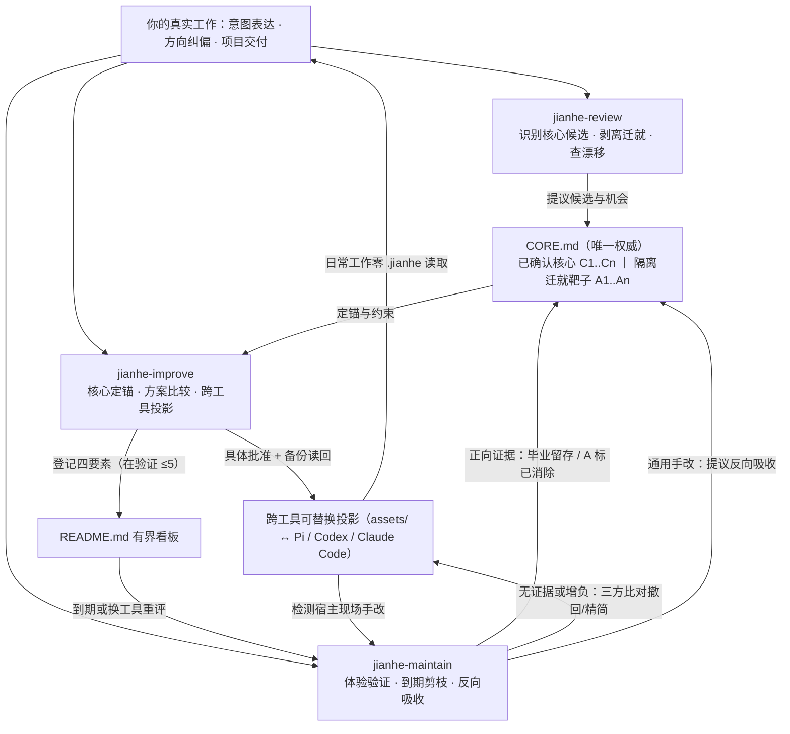

# Jianhe（渐合）

围绕**你**的工作核心持续演进，让所有 AI 工具成为可替换的顺手外骨骼。

**v0.0.4 · 测试版（Pre-release）**。用于真实安装、体验与问题反馈；本文档如实区分已核验契约与尚未完成的真实跨宿主运行验证，不预先承诺未经观察的收益。

[下载 Skill 安装包](https://github.com/zzf2333/Jianhe/releases/download/v0.0.4/jianhe-v0.0.4.zip) · [发布说明与 SHA256SUMS](https://github.com/zzf2333/Jianhe/releases/tag/v0.0.4) · [反馈问题](https://github.com/zzf2333/Jianhe/issues)

---

## 为什么是 v0.0.4：人是唯一主体，Agent 只是投影

很多“Agent 环境优化”容易滑向两个泥潭：要么绕着特定工具堆砌复杂的分组、脚本和规则补丁，工具一换或模型一升级就沦为维护负担；要么只扫日志里的工具报错，把你被工具缺陷逼出来的手工绕行当成“个人习惯”永久写进指令，待办越积越多却从不验证和清理。

Jianhe（渐合）自 `v0.0.4` 起确立**以人为唯一主体的有界递归自我改进（Bounded RSI）闭环**：

- **你的内在核心（`CORE.md`）高于一切工具**：沉淀你真正追求的目标排序、判断品味与完成标准、领域工作法，以及信任与注意力边界。它只记录经你本人确认、可观察的工作要求，绝不做心理或人格黑盒揣测。
- **剥离工具迁就（`A<n>`），拒绝把摩擦固化成习惯**：因为上下文易断、接口繁琐而被迫重复的手工搬运，会被单独识别为待消除的“工具迁就靶子”，用来指导工具改进或借助新原生能力直接剪掉，绝不写进长期规则绑架你。
- **跨 Agent 可替换投影与双向对齐**：Pi、Codex、Claude Code 乃至未来的新工具，都只是承载你工作核心的下游投影（`assets/`）。你在日常顺手改了某份宿主 `AGENTS.md`，维护时会识别并提议**反向吸收**回 `CORE.md`，再按需同步到其他工具，不拿死文档覆盖你的活手改。
- **有界收敛与剪枝退场**：全局看板默认最多同时验证 **5 项**改动（`在验证 ≤5`、`待决定 ≤5`）。每项新增复杂度改动都必须写清预期正信号、代价与到期条件；到期没有真实正向证据的规则或流程，默认提议精简或安全撤回，防止 `.jianhe/` 沦为只增不减的规则坟场。

Jianhe 依然保持**零运行时负担的纯三 Skill 形态**：依靠当前宿主已有的读取、搜索、文档查询、编辑与执行能力独立运作，不附带项目 CLI、后台守护进程或数据库；**普通日常项目开发直接读取宿主原位指令，不读写 `.jianhe/` 目录，日常零额外文件读取开销**。

---

## 三个入口与有界 RSI 闭环

| Skill | 什么时候用 | 帮你得到什么 |
| --- | --- | --- |
| [jianhe-review](./skill/jianhe-review/SKILL.md) | 复盘近期使用、“看看工作方式还能怎样优化”、提炼个人工作准则或排查具体困扰 | 从你的纠偏信号、授权项目产出与跨 Agent 记录中提炼 `CORE.md` 候选、剥离 `A<n>` 迁就靶子、核查双向漂移并发现有核心锚点的改进机会 |
| [jianhe-improve](./skill/jianhe-improve/SKILL.md) | 有新目标、外部文章/Skill、复盘机会，或希望把工作核心投影到单个或多个工具 | 先定锚服务哪条核心或消除哪条迁就，检查看板容量门禁，比较做法并设计以人为中心的工作流与跨工具投影，获准后备份落地并登记验证条件 |
| [jianhe-maintain](./skill/jianhe-maintain/SKILL.md) | 方案用了一段时间、换模型/换工具、清理积压规则，或检查“这套做法真的有用吗” | 对照真实体验与项目交付做四段式评估：有效做法毕业固化，到期无证据或增负方案默认提议精简/三方恢复撤回，反向吸收宿主手改并做元自评 |

三个入口各自目录独立自包含，可以只装一个，也可以配合使用；未安装其他入口时，任一 Skill 都能在获准范围内独立完成闭环。



---

## 安装与首次使用

### 1. 安装完整 Skill 目录

1. 从 Release 下载 `jianhe-v0.0.4.zip` 并解压；核对包内 `VERSION` 与三个 `SKILL.md` 的 `metadata.version` 均为 `0.0.4`。
2. 将 `skill/` 下你需要的**完整子目录**（`jianhe-review`、`jianhe-improve`、`jianhe-maintain`）复制到宿主的技能目录，按宿主方式重载或新开会话。
3. 切回你的日常工作目录或真实项目目录发起对话，不要在本项目源码仓库内当成普通使用环境运行。

> [!IMPORTANT]
> **必须整目录复制，不要只复制单个 `SKILL.md` 文件。**
> 自 `v0.0.4` 起，每个 `jianhe-*/` 目录内部都随附自包含的 `references/contract.md`（四层对象模型与操作契约）和 `references/signal-reading.md`（三级信号与跨 Agent 记录读取，替代 `v0.0.3` 仅在 review 下附带的 `session-reading.md`），三个目录之间没有跨目录文件依赖。

常见用户级技能位置（以所用宿主当前官方文档与实际配置为准）：

| 宿主 | 常见用户级 Skill 目录 |
| --- | --- |
| Pi | `~/.pi/agent/skills/` |
| Claude Code | `~/.claude/skills/` |
| Codex | `~/.agents/skills/` |

`~` 表示当前用户主目录（macOS 为 `$HOME`，Windows 原生环境按 `%USERPROFILE%` / PowerShell `$env:USERPROFILE` 解析，WSL 使用其各自 `HOME`；Windows 实机路径发现与写入尚未实测）。若目标位置已有旧版同名目录，先备份你自己手改过的内容，再替换为 `0.0.4` 完整目录，避免旧文件残留或重名遮蔽。

### 2. 怎么开口用

无需运行初始化命令，也无需预先整理环境调查表：

- **首次建立个人核心与工作方式方案**：
  > 第一次用 Jianhe。请用 jianhe-improve 了解我平时怎样用 AI 完成项目、看重什么质量标准、最烦哪些重复手工操作，帮我整理一份 `CORE.md` 候选和下一步建议，先不改任何工具配置。
- **定期复盘与发现盲区机会**：
  > 用 jianhe-review 复盘上次到现在的使用：重点看我在哪些地方反复纠偏或返工、当前配置有没有偏离我的习惯，提炼核心候选和最值得考虑的改进机会，先只做分析。
- **检验已有方案与清理冗余规则**：
  > 用 jianhe-maintain 检查我之前落地的优化和待验证项：哪些真正在帮我省事可以毕业保留，哪些到期没效果或工具原生已经支持、应该精简撤回？先给我处置建议。
- **评估外部热门技巧或新工具**：
  > 用 jianhe-improve 评估这篇文章/这个新工具的做法适不适合我的工作核心，对比我现有工具的原生能力，讲清楚改后我怎么做一次任务、有什么代价和退出办法。

---

## 用户目录四层结构与日常零开销机制

默认用户根目录为 `$HOME/.jianhe/`（Windows 为 `%USERPROFILE%\.jianhe\`）。只有运行 `jianhe-*` Skill 时才按需读写该目录；平时写代码、做项目时，宿主只读各自原位的 `AGENTS.md` / `CLAUDE.md` 或自身配置，不加载 `.jianhe/`。

```text
.jianhe/
├── CORE.md                         # 1. 用户内在核心（唯一权威：已确认 C<n> / 待确认候选 / 迁就靶子 A<n>）
├── README.md                       # 2. 全局导航与有界看板（维护项索引 / 在验证 ≤5 / 待决定 ≤5 / 下次复盘日）
├── assets/                         # 3. 跨工具投影与维护说明（不复制凭证，不把整份宿主配置当第二来源）
│   ├── agent-workbench/
│   │   ├── README.md               #    含“核心投影映射表”（C<n> 或 A<n>消除 ↔ 投影片段 ↔ 宿主入口）
│   │   └── AGENTS.md               #    获准集中维护的跨宿主共享指令源
│   └── search-mcp/
│       └── README.md               #    原位配置或外部工具登记（记录原路径、受管条目与恢复方式）
└── logs/                           # 4. 两层记录与恢复副本
    └── 20261111-200000-jianhe-review/
        ├── log.md                  #    证据指针、推理取舍、批准原话、实际差异与增量扫描游标
        └── backups/                #    修改目标文件前保存并读回核实的改前副本（按需创建）
```

详细字段规范见 [用户核心、跨工具投影与操作契约](./skill/jianhe-review/references/contract.md)。核心机制包括：

1. **`CORE.md` 六条硬约束**（完整定义见 [contract.md](./skill/jianhe-review/references/contract.md) 1.1 节）：（1）只记可观察的工作要求，禁做心理或人格揣测；（2）观察习惯须有 `≥2` 个独立事件证据才提议候选；（3）未经你明确确认措辞绝不入核或向下游投影；（4）工具限制逼出的迁就 `A<n>` 单独隔离、禁入长期偏好；（5）保持容量与退役卫生（已确认核心每小节建议 `≤7` 条、待确认候选 `≤10` 条，已撤回核心移出正文并检查下游投影）；（6）支持你随时直接手改，你的手改永远高于旧日志，明确拒绝的候选留痕防重复打扰。
2. **可选的日常低摩擦捕获（`[Jianhe 待落盘]` 会话线索）**：经你单独批准后，可在跨工具共享 `AGENTS.md` 末尾放入几行轻约定（原样取自 [contract.md](./skill/jianhe-review/references/contract.md) 1.4 节）。日常会话中当你明示“以后都按这个来”或连续两次同向纠偏时，Agent 只在收尾顺带问一句；你同意且暂不切入 Jianhe 时，它只在当前回复末尾输出一行 `[Jianhe 待落盘]` 文本线索（不是文件日志，不写任何目录，也不保证会话清理后仍能拾取），留待下次 `jianhe-review` 扫描核实你的同意原话后再走正式门禁进入“待确认候选”。
3. **三级信号读取与增量续接**：按 [用户信号、项目产出与跨 Agent 记录读取](./skill/jianhe-review/references/signal-reading.md)，优先看你的意图表达与纠偏，再看当前或明确授权项目仓库内的近期提交演进与返工痕迹，最后看跨 Agent 会话协作成本；按文件位置与末条事件 ID 续接增量游标，严格区分真人交互、子代理、自动任务与演练合成材料，不扫无关私人目录。
4. **有界看板与强制收敛**：`在验证` 满 5 项时自动停止推进新增复杂度的方案（纯删减、修故障、撤回恢复、漂移对齐与确认核心不受阻），倒逼先结算旧改动；每项验证到期若已有任务机会却无正向证据，维护时默认提议精简或撤回，最多有条件延期一次。

---

## 安全、精确批准、三方恢复与诚实指标

- **两层记录与四级日志路径**：在可核对范围内用宿主原生轨迹核对实际工具调用，用 `log.md` 按批及时记录来源覆盖、证据、判断、批准与结果（拒绝保存或日志写入失败时暂停新的正式分析与修改）。日志位置按 **本次明确指定 → 接续原日志 → 用户已明确设置的保存位置 → 默认目录** 解析。
- **写前硬门禁**：任何对 `CORE.md`、维护项、宿主配置或第三方软件的改动，讨论方案都不等于授权；必须先核对现场、保存并读回确认可用的改前恢复依据、在 `log.md` 记清具体方案与你的批准原话及范围，再执行写入并读回实际差异。多项建议只执行你点名批准的条目。
- **三方比对安全恢复**：撤回某项历史优化不是拿旧备份整份覆盖回来，而是同时比对 **原改前内容 / 当时实际改后内容 / 当前现场内容**，只生成撤回该项的反向修改并完整保留你后来作出的其他手改；一旦同一片段已被你改过或恢复依据不全，立即列出冲突暂停并交你裁决。
- **诚实指标与归因边界**：定量观察写明统计对象、窗口与有效机会 `n/N`（如失败 `3/20 → 2/5` 是观察失败率从 `15%` 升至 `40%`，绝不能因次数减少说成改善；`0/0` 无相关任务机会时效果为**未知**，禁写 `0%`）。不从 Token 推算实付账单，不把模型更换或任务差异伴随的数值变化硬算成配置功劳；文件写入成功、宿主加载生效与工作体验改善始终分开报告。

---

## 从 v0.0.3 升级与问题反馈

- **品牌与目录延续**：项目自 `v0.0.2` 更名为 Jianhe，`v0.0.3` 起统一使用 `jianhe-review`、`jianhe-improve`、`jianhe-maintain` 与默认 `.jianhe/` 目录（不提供旧入口别名或自动迁移）。
- **`v0.0.3 → v0.0.4` 平滑升级**：直接用 `v0.0.4` 三个完整 Skill 目录替换宿主技能目录中的旧副本并重载会话即可（确保旧的 `jianhe-review/references/session-reading.md` 随替换一并移除，不再残留）。升级 Skill **不会清空或自动改写**你现有的 `.jianhe/` 数据：首次在老目录运行 `0.0.4` 时，原有日志与资产原样保留，原根 `README.md` 中超过双池上限的旧“待跟进”条目会保留在“旧版待跟进（待分诊）”分批消化，经你确认后逐步提炼 `CORE.md` 与映射表。回退旧版 Skill 目录不等于撤销已对宿主环境作出的配置修改，恢复仍按原事项日志执行。
- **反馈问题**：欢迎在 [GitHub Issues](https://github.com/zzf2333/Jianhe/issues) 提交使用体验或缺陷反馈，建议附上产品版本号（`0.0.4`）、所用宿主与系统、脱敏后的任务场景以及相关 `log.md` 片段（请勿上传包含私钥、Token 或私人源码的原始记录）。

---

## 当前验证范围

`v0.0.4` 已完成四层对象契约、三级信号读取参考、三份自包含 Skill 正文及项目文档的结构与一致性核验：核对了 `VERSION` 与三份 `SKILL.md` 版本元数据一致、三目录 `references/{contract,signal-reading}.md` 的 SHA-256 逐字节一致、全部本地相对链接可达且无跨 Skill 目录文件依赖，并经独立只读 `reviewer` 与 `brain` 复核收口了核心写入门禁、有界看板豁免与投影轻约定（仅输出会话线索、零文件写入）的边界。

历史 `v0.0.3` 基础机制的隔离合成验证记录与已知边界保留如下，不因架构升级重判或抹除：

- **记录读取与事项续接（`v0.0.3` 合成走查）**：曾做两次相连的隔离合成调用，观察到来源分类与去重、同时间戳新增事件、缺失来源保留、暂缓重评及遗漏索引事项找回符合预期；初次产物曾出现六个事项链接失效及将推断写成事实的问题（已保留原件并有界修正，不计为首次自动生成即通过）。随后在两层记录契约下做过一次短合成调用，验证了轨迹身份关联、事项接续与权限判断，但初次存在索引实际更新前提前使用完成语气的时序瑕疵。
- **指标与归因限制（`v0.0.3` 合成走查）**：曾用五项合成汇总验证次数与比例反向、无观察机会、口径与环境变化、部分覆盖与费用缺失、数值变好但归因未确认；主口径判断正确，初次附加算术解释与跨条目样本推断有误，经最小删改后复核关闭。
- **批准、应用与三方恢复（`v0.0.3` 文件层合成链）**：曾用两条建议与临时指令文件验证仅应用获批项、保留后续无关手改并精确三方撤回原项，且写前先建副本并记批准；未覆盖同一片段后续手改冲突、跨文件部分失败及真实宿主加载。

`v0.0.4` 新增机制已完成三场仓库外隔离沙箱的新鲜上下文合成演练（每场仅安装单个目标 Skill 目录，不提供答案提示，核验单 Skill 自包含执行行为与落盘产物）：

- **场景 A（仅安装 `jianhe-review`）**：输入未点明工具名的返工与断片困扰、`v0.0.3` 遗留 7 项待跟进、授权仓库返工提交、含子代理噪声与一条被用户当场否决（“先别记”）的 `[Jianhe 待落盘]` 线索的会话记录，以及被手改过的宿主 `AGENTS.md`。首次自主执行即按游标续读并过滤子代理记录、将两次独立纠偏与仓库返工提炼为候选 `C1`（仅记日志，未建 `CORE.md`、未投影）、将跨会话手贴 `git diff` 隔离为迁就候选 `A1`、识别并拦截被否决的会话线索、检出内容源与宿主手改的双端漂移及单项目参数混入通用约定的问题且未覆盖现场手改，并将 7 条旧版条目原样保留在“旧版待跟进（待分诊）”，新建看板双池链接全部可达。因请求限定“先不要替我敲定正式核心条目”，本次未测试创建 `CORE.md` 文件本身。
- **场景 B（仅安装 `jianhe-improve`）**：输入 `在验证` 已达 `5/5` 满额的看板，同时请求落地一套新增复杂度的“三阶段多角色自动评审流水线”并批准删除 `CLAUDE.md` 中废弃的旧周报规则。首次自主执行即触发 `5/5` 容量门禁拒绝落地流水线（给出隐性串行等待与维护代价去魅分析，暂入 `待决定` `2/5`），同时对获批的纯删减项走豁免通道：先保存并校验改前备份、记清方案与批准原话，再仅删除废弃 3 行并同步资产映射表，如实区分“文件已写”“宿主重载未知”与“实际收益未知”。
- **场景 C（仅安装 `jianhe-maintain`）**：输入 `V1`（8 次任务无正向证据且打扰阅读，获批撤回）、`V2`（`0/0` 无前端任务机会）、`V3`（宿主升级原生支持消除 `A1`，同期集成失败由本地 SQLite `3/20` 变为远程 PostgreSQL `2/5`）及后来新增了 `uv run pytest` 手改行的宿主 `AGENTS.md`。首次自主执行即对 `V1` 完成三方比对安全撤回并完整保留后续手改行、将 `uv run pytest` 提议反向吸收为候选 `C3`（未擅改 `CORE.md`）、判 `V2` 为 `N=0` 效果未知（未写 `0%`）、判 `V3` 因环境与分母变化不可直接比较失败率且功劳归于宿主原生升级、提议获批后标 `A1` 已消除，并输出含采纳率/毕业率与偏航反思的元自评。附注：执行者在获批更新资产 `README.md` 时一并修正了该说明头部的相对路径层级瑕疵（未动历史日志与未获批文件）。

**尚未验证的真实边界**：以上合成演练不能冒充真实多宿主（Pi / Codex / Claude Code）原生自动发现与选用、Windows 实机默认路径解析、同一文本片段被后续手改重叠时的三方冲突暂停分支、跨多轮真实周度演进下的长期收敛效果及真实工作流收益。本项目不附带代码测试框架或自动化评测脚本。

## 许可证

[MIT](./LICENSE)。
