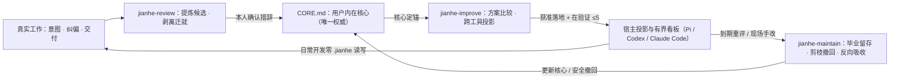

# Jianhe（渐合）

**以人为唯一主体的 AI 工作方式演进引擎——沉淀你的内在工作核心，让各类 Agent 成为可替换的外骨骼。**

`v0.0.4` · Pre-release · 纯 Skill 零运行时 · [下载安装包](https://github.com/zzf2333/Jianhe/releases/download/v0.0.4/jianhe-v0.0.4.zip) · [Release 与校验值](https://github.com/zzf2333/Jianhe/releases/tag/v0.0.4) · [问题反馈](https://github.com/zzf2333/Jianhe/issues)

---

## 立意

AI 编程工具与底层模型迭代极快。围绕单一工具堆砌复杂的分组、脚本和补丁规则，往往在换工具或模型升级后迅速变成维护负担；而只盯着报错日志修补环境，又容易把因工具缺陷被迫养成的人工绕行当成“个人习惯”写进长期指令，让配置越积越厚。

**渐合（Jianhe）** 的出发点很直接：**模型与 Agent 都会过时，只有你自己的工作核心值得长期复利。**

你真正需要沉淀的，是跨工具不变的目标排序、判断品味与完成标准、领域工作法，以及信任与注意力边界。Jianhe 将这套内在核心与具体工具解耦：工具应当渐次贴合人，而不是让人长期迁就工具。

---

## 设计思考

- **内核与外骨骼分离**：由你本人拥有、显式可读的 `.jianhe/CORE.md` 作为跨工具唯一权威，只记录经你确认的可观察工作要求，不做黑盒心理揣测。Pi、Codex、Claude Code 等配置只是下游投影；你在宿主中顺手改出的通用好做法，维护时也能反向吸收回内核。
- **剥离“工具迁就”**：因上下文易断、能力受限而被迫重复的手工搬运（如跨会话手贴 `diff`、手动同步环境），会被单独隔离为待消除的迁就靶子（`A<n>`），随工具升级优先剪除，绝不固化为长期偏好。
- **有界演进，默认剪枝**：全局看板默认最多同时验证 **5 项**改动（`在验证 ≤5`、`待决定 ≤5`），满额即停增新复杂度。每项新增规则或流程须写明预期正信号与到期条件；到期无真实正向体验默认提议精简或撤回，拒绝“只增不减的规则坟场”。
- **纯 Skill 形态，日常零开销**：不附带 CLI、后台进程或数据库，仅由三个独立自包含的 Skill 组成。**日常项目开发完全不读写 `.jianhe/`**，仅在你主动发起复盘、改进或维护时按需介入；可选的日常捕获也只输出单行会话线索，零文件写入。
- **人在回路，三方安全可逆**：讨论方案不等于授权修改。写入前先备份校验并记录具体批准，写入后读回实际差异；撤回旧方案时比对“原改前 / 当时改后 / 当前现场”，完整保留你后来的其他手改；严格区分“文件已写”“宿主已加载”与“真实体验改善”。

### 闭环与三个入口

三个 Skill 目录各自独立自包含，可单独安装，也可串联成有界自我改进（Bounded RSI）闭环：

| Skill | 适用时机 | 帮你完成什么 |
| --- | --- | --- |
| [`jianhe-review`](./skill/jianhe-review/SKILL.md) | 阶段性复盘、提炼个人准则、排查返工或配置偏离 | 从纠偏信号、授权项目产出与跨 Agent 会话中提炼 `CORE.md` 候选，剥离工具迁就，核查双向漂移并发现改进机会 |
| [`jianhe-improve`](./skill/jianhe-improve/SKILL.md) | 有新想法、评估外部技巧/工具，或想落地改进机会 | 锚定服务哪条核心或消除哪条迁就，检查看板容量，比较方案并投影到单工具或多 Agent 协作，获准后备份落地 |
| [`jianhe-maintain`](./skill/jianhe-maintain/SKILL.md) | 方案运行一段时间、换模型/换工具、清理积压规则 | 对照真实体验与项目产出评估在验证项：有效做法毕业留存，到期无证据方案三方比对撤回，反向吸收宿主手改 |



---

## 使用说明

### 1. 安装

1. 下载并解压 [`jianhe-v0.0.4.zip`](https://github.com/zzf2333/Jianhe/releases/download/v0.0.4/jianhe-v0.0.4.zip)。
2. 将 `skill/` 下的**完整子目录**（`jianhe-review`、`jianhe-improve`、`jianhe-maintain`，按需全装或单装）复制到宿主的技能目录。
3. 重载宿主或新开会话，切回你的日常项目目录直接用自然语言对话（无需初始化命令或填写配置表）。

> [!IMPORTANT]
> **请整目录复制，不要只复制单个 `SKILL.md`。** 每个目录内均自带独立的 `references/contract.md` 与 `references/signal-reading.md`。从 `v0.0.3` 升级时用 `0.0.4` 完整目录替换旧目录即可；已有 `.jianhe/` 数据原样保留，超额旧待办会自动归入“旧版待跟进（待分诊）”。

常见用户级技能目录（以各宿主当前官方文档为准；Windows 原生环境将 `~` 对应为 `%USERPROFILE%`）：

| 宿主 | 常见用户级 Skill 目录 |
| --- | --- |
| Pi | `~/.pi/agent/skills/` |
| Claude Code | `~/.claude/skills/` |
| Codex | `~/.agents/skills/` |

### 2. 直接用自然语言开始

- **首次梳理工作核心**：`第一次用 Jianhe。请用 jianhe-improve 了解我平时怎么用 AI 做项目、看重哪些标准、最烦哪些重复手工操作，先帮我整理 CORE.md 候选与建议，暂不改配置。`
- **定期复盘与查漂移**：`用 jianhe-review 复盘上次到现在的使用：看我在哪些环节反复纠偏或返工、现行配置有没有偏离我的习惯，提炼核心候选与改进机会，先只做分析。`
- **评估外部方法或工具**：`用 jianhe-improve 评估这套做法/这个工具适不适合我的工作核心，对比现有工具原生能力，讲清改后怎么用、代价与退出办法。`
- **到期检验与规则剪枝**：`用 jianhe-maintain 检查我之前的优化项：哪些真正在省事可以保留，哪些到期没效果或工具原生已支持、应该精简撤回？先给处置建议。`

### 3. 本地数据目录（按需创建）

默认位于 `~/.jianhe/`，仅在调用 Jianhe Skill 时按需读写，不进入项目仓库，不集中复制任何凭证值：

```text
.jianhe/
├── CORE.md            # 用户内在核心（已确认核心 / 待确认候选 / 工具迁就靶子 / 退役归档）
├── README.md          # 全局导航与双池看板（维护项索引 / 在验证 ≤5 / 待决定 ≤5 / 下次复盘日）
├── assets/<维护项>/   # 跨工具投影说明、共享内容源或原位配置登记（含核心投影映射表）
└── logs/<任务目录>/   # 任务 log.md（证据、决策、批准原话、增量游标）与改前 backups/
```

深入机制细则见随包规范：[`contract.md`](./skill/jianhe-review/references/contract.md)（四层对象契约、`CORE.md` 六条防黑盒约束、日志四级路径解析、双向漂移 5 步规则、三方恢复与可选 `[Jianhe 待落盘]` 轻约定）与 [`signal-reading.md`](./skill/jianhe-review/references/signal-reading.md)（三级信号优先级、跨 Agent 增量游标与诚实指标口径）。

---

## 验证状态与边界

当前版本为 **Pre-release（`v0.0.4`）**，不附带代码测试框架，如实区分已完成核验与未验证边界：

- **结构与一致性核验**：`VERSION` 与三份 `SKILL.md` 元数据一致，三目录 `references/` SHA-256 逐字节一致，全部本地相对链接可达且单目录零外部依赖。
- **隔离沙箱演练证据**：
  - `v0.0.3` 基础机制合成走查：验证了跨来源去重续接、轨迹身份关联与权限判断（初版曾有失效链接、推断作事实及完成语气时序瑕疵，均留档修正）、五类指标限制（比例反向、`0/0` 禁写 `0%`、环境变化不可比等，初版附加算术解释瑕疵已复核关闭），以及写前备份与保留后续手改的三方恢复。
  - `v0.0.4` 三场景仓库外单 Skill 沙箱演练：在仅安装单个目标 Skill 的新鲜上下文中，实测通过两次纠偏提炼候选且不擅建 `CORE.md`、手贴 `diff` 隔离为迁就 `A1`、拦截被当场否决的会话线索、双端漂移检出与旧版待办平滑分诊（`jianhe-review`）；`5/5` 满额阻塞新增流水线并放行纯删减豁免（`jianhe-improve`）；无证据项三方撤回且保留后续手改、宿主手改提议反向吸收、`N=0` 与异构环境不可比判定及元自评（`jianhe-maintain`，其中场景 A 因请求限制未测新建 `CORE.md`，场景 C 顺带修正了获批资产说明头部的相对路径层级）。
- **尚未验证的真实边界**：跨宿主（Pi / Codex / Claude Code）原生自动发现表现、Windows 实机路径解析、同一文本片段被后续手改重叠时的三方冲突暂停分支，以及跨多轮真实日常使用后的长期收敛收益。
- **反馈建议**：欢迎在 [Issues](https://github.com/zzf2333/Jianhe/issues) 反馈体验与问题，建议附上版本号（`0.0.4`）、宿主环境与脱敏后的 `log.md` 片段（勿含私钥、Token 或私人源码）。

---

## 许可证

[MIT](./LICENSE)
