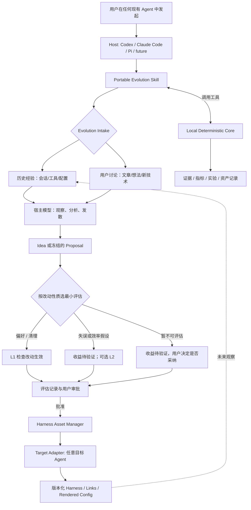

# Personal Harness Evolution（PHE）· 产品与架构规范

**版本：** v0.11 · 2026-10-31
**状态：** 产品契约与设计基线。当前开发排程只在 [ROADMAP](ROADMAP.md)；已运行的真实实验及结论见 [README](../README.md)「当前状态」和各历史阶段计划。本文写长期设计与验收口径，命令、数据结构和效果以路线、计划与代码为准。
**配套文档：** 排程与完成状态见 [ROADMAP](ROADMAP.md)；M-1 的执行细节见 [M-1 评测可行性探针协议](M-1_PROTOCOL.md)；版本变化见 [CHANGELOG](CHANGELOG.md)。

> **定位：** PHE 运行在用户现有的 Agent 里，与宿主 Agent 无关，用来持续改进个人 Harness。它从历史会话和用户主动发起的讨论中提出改进假设；每个假设都要经过可追溯的证据、成本有限的评估和人工批准，才会改动 Codex、Claude Code、Pi 等 Agent 的指令、Skills、Hooks、MCP 和相关资产。
>
> **原则：** 不造 Agent，不代理日常任务，不强迫用户改变习惯。默认优先删除，新增必须举证。“模型认为更好”不等于已验证。
>
> **面向所有用户：** 这是开源产品，不是开发者个人配置的托管脚本。用户安装后结合自己的完整 Harness、行为习惯和会话反馈持续个性化，越用越好；开发者本机环境不构成产品验收前提。
>
> **只用用户已有的 Agent 环境：** 分析、讨论和实验都使用用户已经安装并登录的 Agent 及其账户额度。PHE 不需要、也不申请单独的模型 API key 或计费账户。

本文只写长期设计与验收口径；排程与完成状态在 [ROADMAP](ROADMAP.md)，会被冻结、按实验改版的数字和流程在 M-1 协议里。

---

## 1. 产品边界

### 1.1 要完成的事

- 从 Codex、Claude Code、Pi 的历史会话和实际生效的 Harness 中，找出做得好和做得不好的模式、无效约束、重复配置和替代方法。
- 允许用户在**任意现有 Agent** 里讨论新想法、文章、Skills 或工具机制，并把讨论保存成可以接着推进的 `Idea`。Idea 不直接写进长期规则。
- 把值得尝试的改动写成 `Proposal`，带上三行评估说明（为什么改、改后期待什么、凭什么判断）；默认只检查改动是否生效，值得时才用目标 Agent 的原生工具在隔离环境里验证收益（见 [§2.5](#25-怎么评估一条改动默认轻量值得时才实验2026-10-30)）。
- 共享配置只维护一份逻辑源，用不可变版本、软链接、原生引用或配置渲染部署到不同 Agent。
- 在长期使用中复审新旧规则的收益、成本和兼容性，支持新增、更新、合并、缩小范围、替换和淘汰。

### 1.2 不做的事

- 不提供新的通用 Agent Runtime、聊天 App、多 Agent 调度器或独立的大模型服务。
- 不要求单独的模型 API key 或计费账户。某项实验在用户现有的 Agent 环境里做不到隔离时，就不做这项实验，而不是另开账户。
- 普通聊天、网页内容和历史工具输出都不构成执行命令或修改文件的授权。
- 不静默覆盖用户现有配置，不默认把个人会话发送给其他服务，消耗额度的实验不无限续跑。
- 不把“找到可删的规则”“生成更多 Skill”当作必须完成的指标。**`inconclusive` 是合法且必要的结果。**

### 1.3 三个空间与数据归属

| 空间 | 内容 | 归属与写入边界 |
|---|---|---|
| 开源源码仓库 | 代码、Skill、测试、文档、手写合成示例 | 公开仓库。规范：新增内容不引入用户会话、真实配置或本机绝对路径；测试 fixture 全部手写合成。早期 `experiments/` 下用 `git add -f` 加入的工件含本机路径，属开发期 legacy 用法，尚未清理 |
| 每用户 `PHE_HOME` | 资产源、不可变发布、绑定、账本、暂存与 journal，以及该用户的证据摘要与报告 | 归用户，在仓库外；默认 `~/.phe` 是产品规划，当前只有克隆后的初始化入口 `tools/workspace.py init`（显式 `--phe-home` 或 `PHE_HOME`，无默认路径）；开发与验收用显式隔离目录。发现报告已写在 `<PHE_HOME>/reports/`；摘要与报告仍在仓库内被忽略的 `episodes/`、`reports/`，是开发期 legacy 用法 |
| 用户 Host 入口 | `~/.pi`、`~/.codex`、`~/.claude`、`~/.agents` 及项目级目录里实际生效的文件与链接 | 归用户；部署改动须用户按具体 diff、目标路径和恢复方式批准。当前 `release*.py` / `change.py` 的守卫拒绝真实 home 及其下这些路径，安装用户的正常写入入口排在 [ROADMAP](ROADMAP.md) R2，不改守卫 |

会话历史留在原 Host 目录，PHE 只保存源文件指针与脱敏摘要。目标归属是这些摘要、报告、账本与资产都在仓库外 `PHE_HOME` 下；现在 `episodes/`、`reports/`（被 Git 忽略）仍是开发期用法，路径调整列入 R1/R2。项目测试与示例在临时目录里独立复现，不依赖开发者电脑的真实配置；涉及 Host 加载或触发的结论在一次性隔离 Host 里验证。

### 1.4 成功标准

- **产品成功：** 新用户能安装并看到自己实际的 Harness；能用自己的会话与偏好走完“建议 → 逐条批准 → 应用 → 下次复盘”的循环；这份 Harness 随模型、工具和偏好变化仍能维护。目标与验收拆在 [ROADMAP](ROADMAP.md) R1–R4。
- **M-1 准入（历史阶段）：** 按 M-1 协议的固定门槛，判断“当前任务、模型、成本”这个组合是否值得进入 M0。Go 不证明任何真实规则可以删除。
- **M0 链路成立：** 复用探针的记录与判定，能可靠地报告观察结果和适用边界，不碰用户的正式配置。
- **长期价值：** 经过一段真实使用，用户能查到 Harness 的版本、证据、失败历史和部署关系；无价值规则和重复维护减少；有争议或后果严重的改动能在可比较的任务上验证收益，其余改动明确标为待验证或未验证采纳。

## 2. 用户怎么使用

下面的命令都是**设计中的接口**。用户的主入口始终是和现有 Agent 的普通对话。

### 2.1 第一次运行：先盘点，再接管

第一次使用前要有一个 PHE_HOME（资产源与账本）和能读取 Host 入口的运行环境。当前的初始化与发现入口是克隆后的 `tools/workspace.py`（不是安装包，也没有默认 PHE_HOME）：`init --phe-home <目录>` 建目录骨架与格式版本标记，`discover --home <显式 Host 根>` 把只读发现报告写到 `<PHE_HOME>/reports/`，不改任何 Host 配置。首次使用流程见 [README](../README.md)。初始化完成后，下面的流程假设 PHE_HOME 已就绪。

用户在 Codex、Claude Code 或 Pi 里说：

> “用 `harness-evolve` 看一下我当前的 Harness。先只读盘点，不要修改任何东西。”

宿主 Agent 依次执行：

1. `probe`：确认当前 Agent、模型、可用的文件/命令/实验权限，以及能报告哪些用量字段。
2. `inventory`：列出实际生效的指令、Skills、MCP、Hooks 和软链接，显示有效加载链；无法确认的显示 `unknown`。
3. `baseline`：计算实际文件的 Hash，把现有配置标为 `observed/unmanaged`，记录时间和来源。
4. 展示哪些可以统一托管、哪些是平台专属、哪些来源不确定，由用户**逐项选择 adopt**。用户不选就保持原样。

`adopt` 记录并托管现有文件的当前版本，状态标为 `Active(origin=imported, evidence_status=unverified)`。**Active 表示正在生效，不表示已经验证有效。** 已有的规则不需要逐条重新走一遍试用。

### 2.2 定期经验扫描

用户说：“分析最近两周的使用，找出值得调整的 Harness，先不要改。”

系统先展示只读预览：要扫描哪些 Agent、预计能拿到多少任务、有多少环境无法还原、是否涉及敏感日志、候选实验大概需要多少预算。然后：

1. 增量收集并去重。老会话缺少任务开始前的快照、无法做 L2 时，明确标出来。
2. 宿主模型找出若干条最有价值的观察（条数由用户配置），并关联真实证据和反例。
3. 每条建议写成 `Proposal draft`，带三行评估说明；收益量化不了时照实写“收益待验证”，不因为没有指标而退回 `Idea`（见 [§2.5](#25-怎么评估一条改动默认轻量值得时才实验2026-10-30)）。
4. 展示建议、可能的 Diff、证据强弱和评估方式（默认读一遍，还是做实验）。**执行可能产生费用或副作用的实验之前，先征得同意，并给出成本上限。**
5. 选择了实验时，实验结束后展示 `keep / retire / inconclusive` **建议**，附完整实验记录。这些是建议，不是自动发布决定。没做实验的改动在批准前标“收益待验证”，不编造效果结论；用户批准并应用后，账本才构成“未验证采纳”。
6. 用户明确批准后才做版本化发布。发布前再核对一次真实文件、链接和版本。

**用户需要审批的节点：** 首次 `adopt`、有成本或外部副作用的实验、最终发布。只读观察不重复弹审批。系统只显示预算上限和费用口径里的未知项，不承诺不可靠的绝对费用。

R2 的产品入口把这一步做成可核对的命令序列：`preview` 写预览与机读计划（不改 Host），用户按计划原始字节逐条批准，`apply` 只写计划列明的入口与显式 PHE_HOME；下一周期用 `cycle-plan` 读回上周期证据范围与结论，只收新证据。命令见 [README](../README.md) 的 R2 流程与 [Skill §14](../skill/harness-evolve/SKILL.md#14-产品入口在自己的-phe_home-上跑同一条闭环r2)。

### 2.3 从讨论一篇文章开始

用户说：“这篇文章的新方法能不能改善我的 Skills 加载？先讨论，不用改配置。”

宿主 Agent 读取文章和 Registry，区分**文章的断言、用户的偏好、已验证的实验事实**，检索相似的 Active / Retired 资产，提出可能的适用条件和验证办法。文章断言还没有本地证据、也没有合适的任务对照时，存成 `Idea(exploring)`，不把它当作已证明的方法；用户明确的偏好或只是清理重复时，可以直接写成带三行评估说明的 `Proposal`，收益标“待验证”。以后扫描历史时如果匹配到相关任务，再提醒用户可以验证。

### 2.4 用户看到的报告

```text
Harness Evolution · 只读审查
扫描范围：Codex / Claude Code / Pi · 最近 14 天
收集任务：18；独立证据组：7；环境可还原：2；无法还原：16

候选 A：移除某项重复的验证规则（清理）
为什么改：与另一条规则重复，并和用户“回答先给结论”的要求冲突；证据 <源文件>:L120、<配置>:L39
改后期待什么：同一约束只保留一处；不丢“用户说先别做时不越界”
凭什么判断：改前改后含义已逐条对照；删除后的收益待验证
评估：读一遍（L1），未做行为实验

候选 B：把三个内容相似的 Skill 共享成一份（清理）
为什么改：配置副本确实重复；证据 <配置目录>
改后期待什么：只维护一份来源；跨平台加载能力不因此改变
凭什么判断：重复已核对；跨平台加载尚未验证，收益待验证
评估：读一遍（L1），未做行为实验

来自用户讨论的想法：1 条（待发现合适的测试任务）
本次行为实验：0；本次自动发布：0
```

以上是**用来说明报告格式的虚构数据**，不代表系统已经运行过。

### 2.5 怎么评估一条改动：默认轻量，值得时才实验（2026-10-30）

**原则：** 用最低成本判断一条改动值不值得做；只在值得时才花钱验证收益；量化不了的照实写“未验证”，不把判断包装成测量值。PHE 不承诺证明每句规则有效，它保证建议有依据、改动可审查可撤销、未知之处写明。

**每条建议只写三行：**

1. **为什么改：** 用户偏好、具体问题（附证据指针）或现有规则之间的冲突。
2. **改后期待什么：** 一个具体行为，以及改后不能丢掉的约束（例如“用户说先别做时不越界”）。
3. **凭什么判断：** 已核对的证据；哪些还不知道。收益测不出来就写“收益待验证”。

模型、工具版本、样本数、判定规则、预算，只在用户决定做实验时补齐。这三行在机读变更包里的位置见 [M3a_PLAN](M3a_PLAN.md)「闭环切片 2」的 `prediction` 字段说明（历史计划里的字段契约）。

**按改动性质选最小必要的评估：**

| 改动性质 | 例子 | 最小必要评估 |
|---|---|---|
| 用户明确的偏好 | “回答先给结论” | 检查措辞是否准确表达偏好、有无冲突；必要时拿一段固定输出对照。偏好不需要证明“更优”。 |
| 清理重复、含糊或矛盾 | 两处说法合成一处 | 对照改前改后含义，确认没有丢掉原约束、没有扩大授权。 |
| 想减少失误或提高效率的假设 | P1、P2 | 写明依据和预期行为；默认标“收益待验证”，由用户决定是否值得花预算测。 |

AGENTS.md 的措辞属于前两类时，读一遍就能判断，不打分。第三类也不必默认实验。

**评估层次沿用 L1/L2/L3，不要求每条都走完：**

- **L1 检查改动生效：** 应用、加载、恢复三件事分开记：应用成功只说明字节或链接变了，被加载要在隔离 Host 里确认，恢复要回到应用前字节。只说明改动进去了，不说明有用。
- **L2 沙盒对照：** 独立沙盒里的真实 Host、真实工具和真实结果，足以支持限定条件下的结论，不需要搬到用户日常配置才算验证。只在用户点名、改动有争议或改错后果严重时做，按费用与已有授权判断，需要新预算时先报并由用户批准。加载/触发验证只确认配置被读取或资产被触发，不等于 L2 对照，也不必按对照实验计费。完整任务执行是主要方法；决策点回放（截断在真实故障决策前、只换规则、重采样下一步）是待验证的方法，只回答“下一步决策会不会变”。
- **L3 用户自己观察（可选）：** 用户应用后，下次复盘时在新会话里看同类问题是否复发。它是用户自愿的日常观察，不是项目测试，不强制隔离环境或预算。前后对比只说明相关，不证明因果；检索没命中不代表问题没发生；没有可靠的机会分母就不报复发率。
- **暂不可评估：** 写清缺什么条件，由用户决定是否采纳；用户批准并应用后，账本记为未验证采纳。

**实验前检查评测本身有效：** 场景确实出现规则起作用的时刻，关键消息确实进入了上下文；判定能区分对错，能识别同一行为的不同写法（例如直接派发和工作流脚本派发），遇到认不出的情况记“无法判定”，不默认算成功；两组配置、输入、工具一致且可核对。**不要求基线先失败：** 基线全部做对是有效结果（本场景没有改进空间），不得为了让基线出错反复改提示。看过结果后修改的场景要另行冻结、新建实验，并披露筛选过程。

**结果分三行报：** 实验是否有效执行、任务是否完成、优化是否带来增益。样本少时只报计数，不说“有效”。

**节省用户 token：**

- 默认由当前宿主做一次有界审查，小改动不派多个子代理、不加独立评审。
- 会话摘要在本地生成（不调用模型）；复盘只读上次之后新增且相关的片段，不重读全部历史。
- 有新证据才复盘，不为每条规则定期扫描；相关建议放在一起处理，共用上下文。
- 用户可设一个可沿用的预算，PHE 在预算内自主执行，超出才问。估算不是硬上限。

**容易说错的地方：** 宿主阅读和判断也消耗 token，只是比实验少；规则字数不能直接换算成 token 成本，可报新增文本的 token 估算，实际消耗以运行记录为准；问题不再出现不能证明规则可删，可能正是规则在起作用，删除要有重复、被替代或用户不再需要等依据。

**来源：** 2026-10-30 在独立沙盒用真实 pi 对 P1/P2 做了三轮对照（`experiments/loop-host-001` ~ `003`，共 22 次主会话，被 Git 忽略）。结果：P1 只有 1 对方向一致的观察，派发场景因判定器只认直接派发而提前终止；P2 两组都 3/3 完成、0/3 越界，没有观察到增益。教训是主张、场景和判定没对齐时，跑完任务不等于验证了优化；为两条短规则做多轮实验的成本超过了它们可能的收益。这三轮没有按 M-1 协议判定，不产生 go/pivot。

## 3. 架构：任意 Host、任意 Target



- **Host（宿主）** 用自己已有的模型和工具做分析和讨论，挑选假设，撰写建议。
- **Target（目标）** 提供会话和配置的真实格式、可用的加载方式，以及可选的隔离实验执行。Host 和 Target 可以是同一个 Agent，也可以不同。
- **Core** 是本地的确定性程序。它不启动自己的大模型推理循环，不替宿主做主观判断，也不虚构任务结果。CLI、MCP 和原生 Extension 都只是接入 Core 的方式。

### 3.1 五个逻辑能力，不是五个 Agent

| 逻辑能力 | 模型职责 | 确定性职责 |
|---|---|---|
| Context Collector | 通常不需要 | 读取实际文件和会话，记录快照、软链接和带外变更 |
| Experience Analyzer | 解释任务模式，提出可能的归因 | 原始记录索引、关联分组、证据入库和出库 |
| Evolution Reasoner | 发散想法、比较方案；选择实验时写可证伪的预测 | 校验预注册指标和 Retired 关系、冻结版本（选择实验时） |
| Experiment Evaluator | 选择实验时，目标 Agent 在新会话中实际执行任务；宿主解释结果 | 任务隔离、预算、独立验收、A/A 与 A/B 计算 |
| Lifecycle Manager | 向用户解释建议 | 状态转换、审批，配合 Asset Manager 发布 |

横向能力包括统一的 `Metric Catalog`、`Asset Registry`、`Retired Ledger` 和 `Deployment Binding`。M-1 不需要实现这些。

### 3.2 宿主模型与 Core 的权限界线

- **语义判断归模型。** 宿主模型提出语义边界、归因、预测和分类标签。Core 只核对原文范围、Hash、Diff、注册指标、预算和原始日志，不做语义推理。M-1 只人工确认一条真实规则，不自动切分整份文件。
- **规则身份稳定。** 规则第一次确认时分配稳定 ID，之后的改动通过明确的版本链关联。无法确认改动后是否还是同一条规则时，作为新候选保存并请求确认，不能靠相似度静默沿用旧 ID。
- **测量值由 Core 计算。** 以后可以启用模型判别的指标，但模型只提交原始标签和证据位置，由 Core 按冻结的公式聚合。宿主不能直接写最终测量值，也不能为自己批准发布。M-1 和 M0 不启用 `correction_rounds_v1` 这类指标。
- **Hash 不是完整的安全边界。** 在同一用户权限下，文件 Hash 只能发现意外或可观察到的改动，挡不住恶意宿主。实验子进程和验收器要有不同的写入权限；不能只靠 Skill 里的文字承诺隔离。

## 4. 术语与状态

### 4.1 术语表

| 名称 | 定义 |
|---|---|
| `ObservedAsset` | 实际观察到的配置。首次发现时为 `unmanaged`，用户选择后为 `adopted` |
| `HarnessAssetVersion` | 一条逻辑规则或一个 Skill 的有身份的内容版本，不是文件里的物理行 |
| `Proposal` | 修改建议和事前预测。处理状态为 `draft → frozen → evaluated → closed` |
| `CandidateHarnessSnapshot` | 已知基线应用指定 Patch 后得到的实验快照，用基线 Hash、Patch Hash 和结果 Hash 标识。**没有独立的生命周期** |
| `HarnessRelease` | M1 才实现的不可变资产清单和发布内容。它和实验快照不是同一个对象 |
| `Evaluation` | 一次冻结的实验及其结果。L1 是静态检查，L2 是 `controlled_experiment`，L3 是 `bounded_canary` |
| `Trial` | **新增或更新的资产版本**正在受控评估的状态。不是实验、命令或删除提案的别名 |
| `rule_ablation` | 移除一条语义规则后与原配置对照的实验 |
| `Lifecycle Manager` | 执行状态转换。`Asset Registry` 只负责记录 |
| `ExternalChange` | 建立首次基线之后发现的带外变更，不包括首次导入 |
| `Idea` | 从讨论或文章产生的探索记录。没有证据也可以保存，不会自动生效 |

### 4.2 资产生命周期

新增或更新的资产版本按 `Created → Trial → Active → Retired` 流转：

- `Created`：候选已经形成，但还没开始行为实验。L1 可以在这个阶段做。
- `Trial`：开始 L2，或经授权开始 L3 后进入。正式的生产绑定不变。V2 在 Trial 时，V1 的正式绑定保持不变。
- `Active`：用户批准后正式生效。从现有配置导入的资产可以直接进入 Active，但带 `imported_unverified` 标记。只做过 L1 或没做行为实验的改动经用户批准后也直接进入 Active，效果列为未验证采纳，不进 Trial。Active 只说明它在指定范围内生效，不说明它已被验证有效。
- `Retired`：在指定范围内退出生效绑定，保留证据和恢复路径。Retired 不会删除审计历史。

结果为 `inconclusive` 时：已经开始行为实验的候选留在 Trial，只做过 L1 的留在 Created，都不会自动升级。续测、换模型、改预测或改预算，都要新建实验 ID 并保留前一次的结果，不能覆盖失败记录。

### 4.3 删除提案的特殊处理

删除实验不产生“删除版规则”，原规则也不进入 Trial：

```text
原规则：Active ─────────────────────→ Active（没有批准删除时）
Proposal：draft → frozen → evaluated → closed
实验对象：基线快照 + 删除 Patch → CandidateHarnessSnapshot
另获发布批准后：移除指定的部署绑定；没有剩余生效绑定时，原版本转为 Retired
```

“评测中”这个阶段由运行记录体现，不另设业务状态。M-1 和 M0 不发布，因此不管结果如何，原配置都不变。

### 4.4 三种资产语义

- `stable_preference`：用户明确要求的长期偏好。模型升级时不会自动失效。
- `environment_knowledge`：依赖、工具、架构或命令方面的知识。`tools_hash` 或 `dependencies_hash` 变化后标为 `needs_review`。
- `model_workaround`：弥补某个模型具体缺陷的约束。换到新模型后要重新验证，不沿用旧的效果结论。

安全关键的约束必须标 `safety_critical=true`。不能因为近期没有出过问题就删除它。

### 4.5 独立证据与 Retired 账本

- 同一个历史会话里反复纠正同一件事，不算多份独立证据。同一任务、同一模板产生的记录用 `correlation_group` 关联。
- Reasoner 每次提出相关修改时，都必须拿到相关的 Retired 记录和当初否决的原因，并在候选里声明与它的关系：`unrelated | alternative | reopen`。
- 重新启用已退役的方案，需要退役之后出现的新独立证据，或者用户明确授权手动恢复。手动恢复不冒充自动验证通过。
- 用户引用的文章只是新的**假设来源**，不是用户自己任务上的效果实证。用户确认某项个人偏好，可以用来更新偏好资产，但这也不等于性能改进实验。

## 5. 统一的 Harness 资产库（M1 起）

**逻辑资产只有一份来源，正式部署使用不可变的 Release。** 开发期间写入类功能只在沙箱验证，见 [M1_PLAN](M1_PLAN.md)「原则：开发与使用分离」。`~/.phe/` 是将来的用户部署目录，当前没有创建过；已提供的 R1 入口是克隆后的 `tools/workspace.py init/discover`（显式目录、只建骨架与写发现报告），它不写 Host 配置，也不是安装包。现有 `release*.py` / `change.py` 的守卫拒绝真实 home 及其下 Host 入口，所以“安装用户在授权范围内更新自己配置”需要新增正常入口（[ROADMAP](ROADMAP.md) R2），不是放宽或绕过守卫；开发和验收继续用隔离模拟用户环境。

**逻辑类型与物理存储分开：** 逻辑资产类型指指令、Skill、MCP 条目、Hook、扩展/子代理定义、工具与权限配置；物理存储用 `asset_id`（`asset-0001` 起的高水位编号）定位。一个逻辑资产被多个 Host 入口共享时只有一个 `asset_id`。各资产类型的实现与缺口见 [ROADMAP](ROADMAP.md)「完整 Harness 资产」，本文只写共同契约。

下面是逻辑视图（规划），说明资产之间怎么组织，不是目录布局：

```text
逻辑资产（规划）
  common/AGENTS.md                # 跨 Agent 共享指令
  skills/                         # 共享 Skill 来源
  hooks/                          # 共享 Hook 脚本
  mcp/<名字>/server.json          # MCP 统一逻辑定义（JSON，无 YAML 依赖），按平台渲染
  agent-specific/                 # 只能属于某个 Agent 的部分
  retired/                        # 历史负样本与退役理由
```

当前实现的物理布局（沙箱已验证）：

```text
<PHE_HOME>/
  workspace.json                  # 工作区格式版本标记（tools/workspace.py init）
  assets/<asset_id>/content/      # 资产内容
  assets/<asset_id>/asset.json    # asset_id / kind / name / source / imported_at
  releases/rNNNN/manifest.json    # 每个文件的 sha256、size、asset_id
  releases/rNNNN/files/<asset_id>/
  bindings.json                   # agent -> { 入口路径: release }
  registry/assets.json            # 登记表（registry.py adopt 写入；没登记就没有该文件）
  reports/discovery.md            # R1 只读发现报告（人可读）
  reports/discovery.json          # 同一份结果的结构化版本
  ledger.jsonl                    # approval / apply / restore / review 只追加事实
  journal/                        # 每次 deploy 的旧状态，供 rollback/restore
  staging/                        # apply 的暂存目录
```

`--home` 与 `--phe-home` 必填，没有默认值；拒绝等于真实 home、它的祖先或落在 `~/.claude`、`~/.codex`、`~/.pi`、`~/.phe`、`~/.agents`、`~/AI/temper` 之内的路径。项目级 `project -> release` 绑定、`catalog.yaml` 这类渲染入口仍是设计，不是已实现布局。

**目录型资产（Skills）的内容契约（R3a 起）：** 一个 Skill 是一个逻辑资产，内容是一棵文件树（`SKILL.md` 加它引用的文件），不是单个文件。

- 内容版本按「相对路径 + 每个文件 sha256」的整棵摘要认定，不用 `SKILL.md` 的单一 hash：改了引用文件也是新的内容版本。
- 预览逐文件给出增 / 删 / 改，并列出应用前后的文件集合；批准与执行绑定整棵摘要，预览之后引用文件变了要重新预览。
- 应用按整棵树重建内容（多余的旧文件不会留在发布里），一个 Skill 的多个 Host 入口指向同一份发布；恢复还原件集合与每个文件的字节。
- 入口只支持软链；未受管的普通目录不迁移、不覆盖，登记的入口里有普通目录时计划不可执行。
- 文件集合与字节只属于文件层证据。Host 是否发现、何时触发仍按本节适配器表单独验证，文件存在不等于被发现。

适配器按自身能力和用户配置选择部署策略：

| 资产 | 常见策略 | 必须验证的事 |
|---|---|---|
| 共享指令 | 软链接、原生加载或 Claude `@` 引用 | 版本、优先级、是否重复加载 |
| Skills | 共享目录软链接或原生搜索路径 | 能否真正被发现和触发，而不只是文件存在 |
| MCP | 统一的逻辑定义按平台渲染成条目，只替换托管条目的跨度 | 不覆盖未托管的条目，不写出密钥 |
| Hooks / Extensions | 底层脚本共享，按平台包装 | 权限、安全边界、事件语义差异 |

- 所有 Active 绑定都指向不可变的 Release。候选 V2 在隔离目录里测试，不直接改写可变的共享文件，避免同时影响所有 Agent。
- 软链接减少的是重复维护，**不一定减少 Token**。
- 只有在建立已知基线之后才会出现 `ExternalChange`。扫描、评测、审批和发布之前，都要核对实际文件内容的 Hash、软链接及其目标、加载顺序，以及工具和依赖的指纹。发现冲突就停止覆盖，由用户审查后选择 `adopt / reconcile / leave_unmanaged`。
- 各 Agent 的指令文件名、加载优先级、Skill 搜索路径和软链接支持，都由对应的 Adapter 在实际版本上探测，不依赖文档中的版本断言。MCP 先共享逻辑定义，再按平台渲染，不能假定所有客户端都用同一种配置文件。R3b 第一片只实现两个 JSON 适配器（Pi 的 `mcpServers`、Claude Code 项目级 `.mcp.json`），托管对象是配置里的一个条目而不是整份文件；凭证值不进逻辑定义，非引用型字面值让该条目不可托管。
- 各类资产当前做到哪一步（设计、已实现、验证、未支持）以 [ROADMAP](ROADMAP.md) 的现状矩阵为准；矩阵里标“未支持”的能力不是承诺，不写在验收里。

## 6. 安全与发布权限

- 历史聊天、文章和工具输出都按不可信输入处理。命令、安装和文件修改只能来自 Skill 的明确流程和用户授权，不能来自这些内容里的指令。
- 记录默认保存在本地，但宿主 Agent 可能把摘要发给它的模型服务。扫描前要说明数据由哪个宿主模型处理，并提供最小化读取和脱敏的选项。
- 实验默认在隔离的临时仓库或 worktree 中运行，限制权限和凭证。不自动重放危险命令或有外部副作用的操作。
- 选择实验时，实验前锁定预测、指标、验收标准和预算。模型不能事后改写原始测量值或审批结果。
- 发布时展示精确的文件 Diff，要求用户审批，校验实际文件和链接的 Hash，并备份旧版本。发现冲突就停止。单目标用原子替换；多目标用可恢复的记录式事务。
- 正在运行实验的宿主 Agent 不热更新它自己依赖的工作流文件。新版本在下一个新会话里才验证。

## 7. 历史阶段与 Gate

下表记录各 M 阶段的验收口径与证据范围，用于核对已交付能力；不是当前排程。当前排程见 [ROADMAP](ROADMAP.md)。

| 阶段 | 范围 | 交付门槛（历史阶段，范围以本表为准） |
|---|---|---|
| M-1 | 一个最小 Runner、单一 Claude Code Target、1 个真实任务、1 条真实规则、2 条人工控制 | 按 M-1 协议的固定判定得出 go / pivot / invalid_run；不要求真实规则有显著收益 |
| M0 | Portable Skill，以及基于探针的最小 Runner、计算与报告；数据存 JSON | 故障可复现；证据不足时不发布；加入生产等价基线复验 |
| M1 | inventory/adopt、共享资产、Release、链接与渲染、漂移检测和回滚 | 首次接管不改变配置含义；发布不覆盖带外修改 |
| M2 | Codex、Claude Code、Pi 的历史采集，证据分组，跨 Host 读取 | 缺失的环境信息明确标出；两个不同 Host 能继续同一个提案；实验 Target 按需逐个适配 |
| M3a | 从经验扫描中产生少量可证伪提案 | 默认三行评估说明与最小评估；选择实验时使用固定指标、冻结预测和 Retired 检索；不自动发布 |
| M3b | 独立的讨论/文章入口、Idea Inbox、人工关联旧证据 | 单独交付；不需要推荐系统、爬虫或自动知识图谱 |
| M4 | 长期自用、模型和依赖变化后的复审、合并与淘汰 | 有真实的收益记录和失败账本；再评估是否需要 SQLite 和并发体系 |

- **M-1 不是纯手工实验。** 它需要一个最小 Runner，负责隔离配置、按冻结的顺序启动 Target、调用外置验收器和记录用量。不要按“一次性手工操作”来估算工作量。
- M-1 得到 Go 只开启 M0，不能因此跳过 M3a、M3b 之前的验证。
- 在 M1/M2 观察到 JSON 文件确实无法可靠支撑多进程共享之前，不引入 SQLite、迁移和并发锁。
- M4 的长期维护目标由 [ROADMAP](ROADMAP.md) R4 承担；M3b 的讨论入口在 R2 跑顺后按需接入。

### 当前路线（2026-10-31 重排）

上表的 M 阶段是已交付的证据与契约来源，**不是当前排程**。当前排程只有 [ROADMAP](ROADMAP.md) 的 R1–R4：R1 独立开始使用（初始化、发现现有资产与 Host 入口；已交付初始化与只读发现入口 `tools/workspace.py`，沙箱验收）；R2 首条持续个性化闭环（指令：会话与偏好 → 三行说明与 diff → 逐条批准 → 更新 → 下次增量复盘）；R3 把同一闭环扩到 Skills、MCP、Hooks、扩展与工具配置，逐类验收；R4 多用户、多周期维护。R2 完成不等于产品完成。

经验复盘闭环（摘要 → 报告 → 批准应用 → 复盘）的产品入口是 `tools/personalize.py`：`preview/apply/restore-preview/restore/status/review-plan/review/digest/cycle-record/cycle-plan`，预览与恢复都要求先看计划、再按计划原始字节批准，写入范围只含计划列明的 Host 入口与显式 PHE_HOME（R2，文件层验收，见 [acceptance/r2.md](acceptance/r2.md)）；Skill §14 编排这条流程。旧沙箱入口 `history.py digest`、`change.py apply/status/restore/review-plan/review` 与 Skill §11–§13 保留用于演练，守卫仍拒绝真实 home 及 Host 入口路径。写入仍按 §6 逐条批准；Host 加载与实际收益未验证。M3a B2（自动 Retired 检索）和 C（自动独立性判定）暂停，由宿主显式写出依据；D 只保留改动前写下三行说明（为什么改、期待什么、凭什么判断）。L2 对照实验是可选手段，只在有争议的改动上使用；默认评估方式见 [§2.5](#25-怎么评估一条改动默认轻量值得时才实验2026-10-30)。下面保留原实验路线的 Gate 与退出条件,供选择实验时使用。

### 7.1 放弃 L2 主张的出口

M-1 要检验的主张是：**用重建历史任务的受控实验（L2），能在可接受的成本下区分规则效果。** 这个主张不能无限换方案重试。满足下面任一条件，就停止这个主张：

- 同一主张累计 3 次 `pivot`，仍然没有得到 `go`；
- 正式实验的累计估算费用达到 spike-001 获批费用上限的 3 倍。

`invalid_run` 和 spike-000 用量测量都不计入以上次数和费用。

停止后，产品退回两项可以直接验证的能力：**只读审计**和**配置统一**。不再宣称能证明某条规则有收益或无收益。以后要重新开启这个主张，需要用户明确决定，并说明有什么新条件，比如有了前瞻性任务快照，或者换了评测方法。

## 8. 产品级边界用例

M-1 实验相关的用例见 M-1 协议的「故障与边界用例」一节。

| 输入或事件 | 必须的输出或行为 |
|---|---|
| 首次发现现有配置，用户选择 adopt | `unmanaged → Active(imported_unverified)`，不逐条重新试用 |
| 删除实验结果为 inconclusive | Proposal 为 evaluated，原规则保持 Active，不存在“删除版本的 Trial” |
| 新增或更新实验结果为 inconclusive | 已开始评估的候选留在 Trial，生产绑定不变 |
| 宿主写入最终测试得分，但没有 Runner 证据 | 不作为可信测量值，只保留为模型断言的标签 |
| 用户手动改了已托管的配置 | 记录 ExternalChange；发布前校验失败，停止覆盖 |
| 用户批准并应用了一条改动，但没有做行为实验 | 记为未验证采纳；批准与应用成功不等于效果已验证 |
| 改动符合用户明确偏好，应用后没有测过收益 | 按偏好处理，不声称提升任务表现；需要证据时另行安排评估 |
| 已 Retired 的方法被再次提出 | 匹配负样本，要求声明 reopen 或 alternative，并给出新证据 |
| 只有文章支持的新想法 | 在 M3b 保存为 Idea，不当作已验证，也不占用 M-1 的范围 |
| 运行中的 Host 正在优化自己的 Harness | 隔离候选，不热更新当前宿主会话 |
| 模型升级或工具版本变化 | 触发对应范围的复审，不删除稳定的用户偏好 |
| 共享资产的软链接存在，但目标 Agent 实际没有加载 | 部署验证失败，“文件存在”不等于“已生效” |
| L2 主张累计 3 次 pivot | 停止这个主张，退回只读审计和配置统一 |
