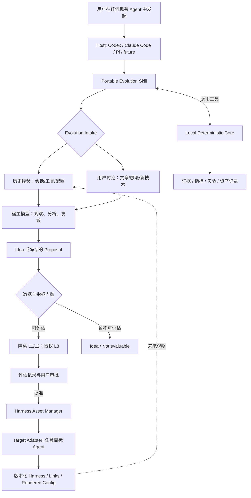

# Personal Harness Evolution（PHE）

**开发基线 v0.4 · 2026-10-28**  
**文档路径：**`docs/PHE_SPEC.md`  
**状态：**待执行 M-1；本文与附带 JSON 都是预注册设计，**尚未运行真实 Agent 实验、也没有实验结论**。不得把本文件中的拟议命令或实验效果描述成已实现功能。

> **定位**：运行在用户现有 Agent 内的、与宿主无关的个人 Harness 持续进化机制。它利用历史会话与用户主动讨论产生改进假设，经可追溯证据、有限成本的评估和人工批准，持续维护 Codex、Claude Code、Pi 等 Agent 的指令、Skills、Hooks、MCP 与相关资产。
>
> **不造 Agent、不代理日常任务、不强迫改变使用习惯；默认删除优先、新增举证，绝不把“模型认为更好”等同于已验证。**

---

## 0. 本版决策与阅读入口

本文是唯一开发基线，品牌工作名为 Harness Grove，机制名仍为 Personal Harness Evolution（PHE）。v0.4 修订点如下：

| 审查问题 | 本版决定 | 规范位置 |
|---|---|---|
| Go/Pivot/Stop 没有阈值 | 固定计数、噪声、预算与决策优先级；运行前写入并冻结 `proposal.json` | §5.5–5.7 |
| 控制规则选择循环 | 人工构造信息承载规则与冗余副本；真实规则的效果保持未知 | §5.3 |
| 15 次容不下全部实验 | A1/A2/B_real/B_required/B_redundant 各 5 次，共 25 次 | §5.4 |
| 路径与仓库不明确 | M-1/M0 产物只进 `${PHE_REPO}/experiments/`；目标仓库只读 | §5.1、§7 |
| Target 未固定 | 仅 M-1 固定 Claude Code；Host 与长期框架仍与 Agent 无关 | §5.2 |
| 删除时谁处于 Trial | 删除不制造新资产版本；冻结的是 Proposal，测试的是只读快照加 Patch | §4.1 |
| 文档并存、M3 范围膨胀 | 旧路径只留弃用指针；M3a 历史入口，M3b 独立交付 Idea 入口 | §11 |

先读 §5 的探针协议和 §11.2 的首次任务。M-1 之前不搭 SQLite、完整 Schema、自动 Reasoner 或多平台实验 Runner。

这些数值是本项目选择的**工程准入门槛**，不是论文证明的统计阈值。用户可在实验前批准另一套预算或阈值；一经冻结，不得依据结果修改同一实验。

## 1. 产品边界与成功标准

### 1.1 应该完成的事

- 从 Codex、Claude Code、Pi 的历史会话及实际生效 Harness 中，发现工作做得好/不好的模式、无效约束、重复配置与替代方法。
- 允许用户在**任意现有 Agent** 中就新的想法、文章、Skills、工具机制发起探讨；形成可保存、可继续的 `Idea`，而不是直接污染长期规则。
- 将值得尝试的变化转为带**具体预测和验收方法**的 `Proposal`，利用原生 Agent 工具在隔离环境评估。
- 对共享配置建立一份逻辑资产源，通过不可变版本、软链接、原生引用或配置渲染部署至不同 Agent。
- 在多轮使用中审查新旧规则的收益、成本与兼容性，支持新增、更新、合并、缩小作用范围、替换和淘汰。

### 1.2 不做的事

- 不提供新的通用 Agent Runtime、聊天 App、自动多 Agent 工作调度器或独立大模型服务。
- 不把普通聊天、网页内容、历史工具输出视作可以执行命令或修改文件的授权。
- 不静默覆盖用户现有配置，不默认把个人会话发给另一个服务，不把付费实验无限续跑。
- 不以“找到可以删除的规则”“生成了更多 Skill”作为一定要完成的指标；**`inconclusive` 是合法且必要的产品结果**。

### 1.3 两级验收

**M-1：探针准入**：按 §5 的固定门槛判断当前任务/模型/成本组合是否值得进入 M0。Go 不证明任意真实规则可以删除。**M0：最小链路成立**：复用探针的记录与判定，能可靠报告观察结果及其边界，不碰用户正式配置。

**后续长期价值**：经过一系列真实工作，用户可复查其 Harness 的版本、证据、失败历史与部署关系，减少无价值规则和重复维护，并在可比较任务中验证收益。

## 2. 用户实际怎么使用

所有命令如下仅是**设计中的接口**；用户的主入口始终是和现有 Agent 的普通对话。

### 2.1 第一次运行：先盘点，再接管

用户在 Codex、Claude Code 或 Pi 中说：

> “使用 `harness-evolve` 看一下我当前的 Harness。先只读盘点，不要修改任何东西。”

宿主 Agent 执行：

1. `probe`：核实当前 Agent、模型、可用文件/命令/实验权限、预估可报告的用量字段。
2. `inventory`：枚举真实指令、Skills、MCP、Hooks 与软链接；显示有效加载链，无法验证时显示 `unknown`。
3. `baseline`：计算实际文件 Hash，标记现有配置为 `observed/unmanaged`，记录时间与来源。
4. 展示“哪些可以统一托管、哪些平台专属、哪些来源不确定”，由用户**选择性 adopt**；没有选择则保持原样。

`adopt` 的语义：记录并可选择托管现有文件的当前版本；标记 `active`（因为本来就在生产环境生效）、`origin=imported`、`evidence_status=unverified`。**Active 表示部署状态，不等于经过评测证明有效。** 不强迫已存在的 N 条规则逐条进入 Trial。

### 2.2 定期经验扫描：用户最少需要做什么

用户说：“分析最近两周的使用，找出值得调整的 Harness，但先不要改。”

系统先展示只读预览：会扫描哪些 Agent、预计能取得多少任务、未知环境数量、是否涉及敏感日志、运行候选实验可能需要的预算。然后：

1. 增量收集与去重。因老会话缺少任务前快照而无法 L2 时明确标记。
2. 宿主模型识别最多若干条高价值观察（条数由用户配置），关联真实证据与反例。
3. 对能够计算指标的建议生成 `Proposal draft`；否则作为 `Idea` 或 `not_evaluable` 保存。
4. 显示建议、可能的改动 Diff、证据强弱、可选实验成本上限；在**执行可能产生费用或副作用的实验前**征得同意。
5. 实验完成展示 `keep / retire / inconclusive` **建议**（不是自动发布决定），并附完整实验记录。
6. 只有用户明确批准，才执行版本化发布；提交前再次核对真实文件、链接和版本。

**用户预计审批的节点**：首次 `adopt`、授权有成本或外部副作用的实验、最终发布；只读观察不重复弹审批。系统显示预算上限和未知费用口径，而不是给出不可靠的绝对费用承诺。

### 2.3 从讨论一篇文章开始

用户说：“这篇文章的新方法能不能改善我的 Skills 加载？先讨论，不用改配置。”

宿主 Agent 读取文章和 Registry，区分**文章断言 / 用户偏好 / 已验证实验事实**，检索相似 Active / Retired 资产，提出可能的适用条件与验证办法。如果当前没有可观测指标或测试任务，就保存 `Idea(exploring)`，**不强制生成 Proposal**。日后历史扫描可匹配到相关任务并提醒可以验证。

### 2.4 用户看到什么报告

```text
Harness Evolution · 只读审查
扫描范围：Codex / Claude Code / Pi · 最近 14 天
收集任务：18；独立证据组：7；环境可还原：2；无法还原：16

候选 A：移除某项旧验证规则
证据：2 个关联组，1 个反例
预注册指标：test_pass_v1、total_tokens_v1
状态：可以试验，但尚无结论
实验：必须单独批准预算；生产配置不变

候选 B：共享三个内容相似的 Skill
证据：配置副本确实重复；跨平台加载尚未验证
状态：结构优化候选，不能声称降低 Token

来自用户讨论的想法：1 条（待发现合适的测试任务）
本次自动发布：0
```

这些是**说明界面格式的虚构数据**，不代表已运行系统。

## 3. 架构：任意 Host、任意 Target



**Host 负责**：调用已有模型与工具执行分析、讨论、选择假设、撰写建议。**Target 负责**：提供会话与配置的真实格式、可用加载方式、可选的隔离实验执行。Host 和 Target 可以相同，也可以不同。

**Core 不负责**：自己启动大模型推理循环、替宿主做主观推理、虚构任务结果。CLI / MCP / 原生 Extension 只是它的可选工具接入方式。

### 3.1 五个逻辑能力、不是五个 Agent

| 逻辑能力 | 模型职责 | 确定性职责 |
|---|---|---|
| Context Collector | 通常不需要 | 读取实际文件 / 会话，记录快照、软链接和带外变更 |
| Experience Analyzer | 解释任务模式、提出可能归因 | 原始记录索引、关联分组、证据出入库 |
| Evolution Reasoner | 发散想法、对比方案、产出可证伪预测 | 校验预注册指标、Retired 关系、冻结版本 |
| Experiment Evaluator | 目标 Agent 在新会话中实际执行；宿主解释 | 任务隔离、预算、独立验收、A/A 和 A/B 计算 |
| Lifecycle Manager | 对用户解释建议 | 状态转换、审批与 Asset Manager 协同发布 |

横向能力包括统一 `Metric Catalog`、`Asset Registry`、`Retired Ledger`、`Deployment Binding`。它们在 M-1 中**不需要全部实现**。

## 4. 术语、状态与数据所有权

| 名称 | 唯一定义 |
|---|---|
| `ObservedAsset` | 实际观察到的配置，首次为 `unmanaged`；用户选择后 `adopted` |
| `HarnessAssetVersion` | 一条逻辑规则/Skill 的有身份内容版本，不是文件物理行 |
| `Proposal` | 修改建议和事前预测，处理状态 `draft → frozen → evaluated → closed` |
| `CandidateHarnessSnapshot` | 已知基线应用指定 Patch 后的实验快照，由基线 Hash、Patch Hash、结果 Hash 标识；**没有独立生命周期** |
| `HarnessRelease` | M1 才实现的不可变资产清单与发布内容；与实验快照不是同一对象 |
| `Evaluation` | 一次冻结实验及其结果；L1 静态检查，L2 `controlled_experiment`，L3 `bounded_canary` |
| `Trial` | **新增/更新资产版本**的受控评估状态；不是实验、命令或删除提案的别名 |
| `rule_ablation` | 移除一个语义规则的对照实验；不再另称 Removal Evaluation |
| `Lifecycle Manager` | 执行状态转换；`Asset Registry` 只负责记录 |
| `ExternalChange` | 建立首次基线后发现的带外变更，不包含首次导入 |
| `Idea` | 从讨论/文章产生的探索记录；不具备证据时也可保存，不自动生效 |

### 4.1 生命周期与删除的特殊处理

新增/更新版本使用 `Created → Trial → Active → Retired`。Created 可做 L1；开始 L2 或授权 L3 才进入 Trial。V2 试验时 V1 的正式绑定不变。

**删除实验不产生“删除版规则”，也不让原规则进入 Trial：**

```text
原规则：Active ─────────────────────→ Active（没有批准删除时）
Proposal：draft → frozen → evaluated → closed
实验对象：基线快照 + 删除 Patch → CandidateHarnessSnapshot
只有另获发布批准后：移除指定部署绑定；无剩余生效绑定时原版本 Retired
```

M-1/M0 不发布。因此无论实验 Go、失败还是 inconclusive，原配置都不改变。删除提案评测结束后为 `evaluated(result=inconclusive/pass/fail/...)`；“评测中”由运行记录表示，不增加新业务状态。

新增/更新候选若结果 inconclusive，已开始行为实验的版本留在 Trial；仅做 L1 的留在 Created。续测、换模型、改预测或预算，都新建 experiment ID 并保留前次结果，不能覆盖失败记录。

已存在配置被 adopt 可直接 `Active(origin=imported,evidence_status=unverified)`。Active 只说明在指定范围生效，不代表经验证有效；Retired 不是删除审计历史。

### 4.2 模型与 Core 的权限界线

宿主模型提出语义边界、归因、预测和分类标签。Core 核对原文范围、Hash、Diff、注册指标、预算与原始日志，不承担语义推理。M-1 只人工确认一条真实规则，不自动切分整份文件。

规则首次确认赋稳定 ID；改动通过明确版本链关联。无法确认是否仍为同一规则时保留新候选并请求确认，不能用相似度静默续接 ID。

模型判别指标日后可启用，但模型只提交带证据位置的原始标签；Core 依据冻结公式聚合。M-1/M0 不启用 `correction_rounds_v1`，不让宿主直接写最终测量值或为自己批准发布。

同用户权限下，文件 Hash 只能检出意外/可观察的改动，不是防御恶意宿主的完整安全边界。实验子进程与验收器需有不同写入权限；不能仅靠 Skill 文本承诺隔离。

## 5. M-1：可执行的评测可行性探针

### 5.1 仓库、任务与前置检查

必须明确两个绝对路径：`PHE_REPO` 是 Harness Grove 开发仓库；`TARGET_REPO` 是真实任务的来源仓库。M-1 要求两者为不同目录，且不存在父子包含关系；不得把“扫描当前仓库”作为默认行为。

| 路径 | 可做什么 |
|---|---|
| `${PHE_REPO}/experiments/spike-001/` | 唯一的持久实验产物目录 |
| `${TARGET_REPO}` | 只读获取请求、起点快照和配置；不 reset、checkout、装依赖或新增文件 |
| `${TMPDIR}/phe-spike-001-*/` | 一次性基线仓库及每次运行的新 worktree、隔离配置和临时依赖 |
| `~/.phe/` | M1 以后用户选择使用的资产部署目录；M-1/M0 禁止写入 |

从任务起点快照建立**只含该起点的一次性 Git 仓库**，再在其中创建临时 worktree。不直接在源仓库执行 `git worktree add`，避免修改其 `.git` 元数据。不给实验 Agent 暴露未来修复提交、正确答案 Patch、其他组日志或整份 proposal。每个配置的临时初始提交只包含该组最终配置；不能通过 `git show HEAD`、父提交或相邻目录取回已删除规则。各组基线 Hash 分开记录。

开始付费调用前，完成三个不调用模型的检查：

- 起点快照独立重建 3 次，文件清单 Hash **3/3 一致**；依赖、构建过程与验收入口可固定。
- 外置真实任务验收器对未修复起点 **3/3 失败**，对人工确认的已修复版本 **3/3 通过**。这检验验收器是否测到了任务，不只检查已有 CI。
- 校准回执验收器对缺失/错误回执和正确回执均 **每类 3/3 判断正确**；验收器与期望值不受实验 Agent 写入或读取。真实验收测试由外置可信副本运行，不以 Agent 修改后的测试文件为准。

真实任务缺少请求、起点或可用验收器时，输出 `pivot`，原因 `historical_task_not_reconstructable`。可以另立前瞻性 Fixture 实验，但不得沿用当前 experiment ID 冒充历史复现。

### 5.2 M-1 只固定 Target，不固定 Host

**Target = Claude Code，本阶段唯一用量适配器 = `claude_result_modelUsage_v1`。** Codex、Claude Code 或 Pi 均可作为 Host 编排此探针；这不是项目永久绑定 Claude。

采用 `claude -p --output-format json` 的新会话模式。冻结实际 CLI 版本、可执行文件 Hash、提供商、完整模型 ID、推理设置、参数与权限配置。不得只写 `sonnet` 等可变别名，不使用 resume、模型 fallback、子 Agent 或自动重试。无法获取的服务端权重修订号记 `unknown`，不假装完全固定了云端内部实现。[S1][S2]

在隔离用户配置/文件系统内，按原作用范围加载冻结的 `CLAUDE.md` 与必要引用，核对加载来源。禁止继承未冻结的个人记忆、插件、Hooks 或 MCP；每次运行恢复同一配置快照。**不使用 `--bare` 来冒充原生 CLAUDE.md 实验**，因为该模式会跳过其自动发现。[S2]

只暴露任务所需的读写/终端工具，限定文件系统与网络。worktree 本身不是权限沙箱。加载链无法核实则 `pivot(load_chain_unknown)`；无法落实隔离则 `stop_claim`。认证只保存引用，不能把密钥复制进实验文档或日志。

### 5.3 人工控制规则：不从未知真实规则里挑“正确答案”

保留一个效果未知的真实非安全规则 `R_real`。另外构造两个只用于探针的规则：

**必要信息控制 `C_required`**：在规则中给出一个新生成的 128-bit 随机回执值，要求完成任务后在临时工作区写入 `.phe-calibration-receipt`。该值不在原始需求、代码、历史、可见验收器或文件名中出现。外置验收器检查真实任务通过且回执精确匹配。

它只对**人工校准契约**必要，不宣称对真实业务必要。撤掉该规则是明显的信息缺失控制，用于检查规则是否被传递及验收器能否发现差异。随机值在一次实验中固定；各运行隔离，不能从其他组读取它。

**冗余控制 `C_redundant`**：复制一条已存在、与本任务无关且无冲突的普通句子。删除新增副本后原句仍在；它不能复制 `R_real`、回执规则或安全规则。先对 Diff 做人工确认。它是“预期中性”的控制，**不是保证模型绝不受措辞影响**；若结果改变，就按门槛报告校准失败。

统一共同基线：`H* = 原 Harness 冻结快照 + C_required + C_redundant`。所有组均从 H* 派生，每次只删指定规则。H* 不是未经改动的生产 Harness；这一点必须写进报告，避免把探针结论直接用于生产删除。

### 5.4 25 次运行：两个控制没有额外隐藏预算

| 组 | 配置 | 次数 | 用途 |
|---|---|---:|---|
| A1 | H* | 5 | 同配置对照一 |
| A2 | H*，与 A1 内容 Hash 相同 | 5 | 同配置对照二 |
| B_real | H* 减去 R_real | 5 | 真实规则的探索性信号 |
| B_required | H* 减去 C_required | 5 | 必要信息控制 |
| B_redundant | H* 减去新增冗余副本 | 5 | 中性控制 |
| **总计** | | **25** | 包含全部 Target 调用 |

5 个区组，每区组每个配置运行一次；组内顺序事前随机化并写入 proposal，最终保存的 25 项顺序为准。顺序种子是调度种子，**不是模型随机种子**。并发固定为 1，每次新进程、新工作区、新会话。

A/A 门槛在结论判断时先执行；运行顺序采用交错区组而非先完成一整组，以降低时间、缓存和服务波动的混淆。必须记录缓存 Token；不能宣称缓存已完全消除。

25 是**最多启动次数**，不是一定完成数。启动失败、超时和崩溃均占用原 slot，不免费补跑；没有额外模型预热或“先测一下”调用。缺少有效运行就不能 Go。任务未通过但进程正常结束、原始计量完整，属于有效的失败结果，不从分母剔除；缺失日志、基础设施错误和预算截断则为无效/不完整 slot。非模型的快照/验收器自检不计 Target 次数，但记录其耗时。

### 5.5 指标、噪声与写死的门槛

对每组定义 `S[g]` 为真实任务通过次数，`C[g]` 为“真实任务通过且回执正确”的次数；两者分母固定为 5。它们是不同指标，不能混用。

定义 `T[g]` 为该组 `total_tokens_v1` 中位数；`T[A]` 为 A1/A2 共 10 次的合并中位数。再定义：

```text
N_gap = abs(T[A1] - T[A2]) / T[A]
N_mad = median(abs(token_i - T[A]), i in A1 ∪ A2) / T[A]
N_cost = max(N_gap, 2 * N_mad)
```

中位数在偶数样本时取中间两值平均；MAD 不乘额外缩放系数。缺失用量或 `T[A] <= 0` 不能把噪声记 0，必须 Pivot。

| Gate | v0.4 固定准入条件 |
|---|---|
| 完整性 | 25 个 slot 全部有有效结果及完整冻结口径计量；无漂移、泄漏、验收器被改写、生产变更 |
| 基线能力 | `S[A1] >= 4` 且 `S[A2] >= 4`；`C[A1] >= 4` 且 `C[A2] >= 4` |
| A/A 质量波动 | `abs(S[A1]-S[A2]) <= 1` 且 `abs(C[A1]-C[A2]) <= 1` |
| A/A Token 波动 | `N_gap <= 0.25` 且 `N_mad <= 0.30` |
| 必要信息可识别 | `min(C[A1],C[A2]) - C[B_required] >= 3` |
| 冗余控制不误报 | `S[B_redundant] >= 4` 且 `C[B_redundant] >= 4`；S、C 与 A1、A2 的计数差均不超过 1 |
| 资源 | 满足 §5.6 所有时间、Token 与估算费用门槛；未遇到预算终止 |

计数差 3/5 是 **60 个百分点**，不是相对下降 60%。这些 Gate 检查工程可行性，不是显著性检验；只有 1 个独立任务组，重复 25 次不能写成 25 个独立任务。

### 5.6 固定预算与预算执行方式

| 项目 | v0.4 默认值 | 执行含义 |
|---|---:|---|
| Target 启动次数 | 25 | 不额外重跑、预热或补样本 |
| 单次 Agent 回合 | 20 | CLI 回合上限；触限仍计入本次启动 |
| 单次进程时间 | 180 秒 | Runner 超时终止，最多 3 秒清理宽限 |
| 单次外置验收 | 30 秒 | 超时为验收无效，不冒充任务失败 |
| 整个实验墙钟 | 5,400 秒 | 首次 Target 启动至结束，含重建与验收，不是完成时间承诺 |
| 单次已报告 Token | 100,000 | 超过即停止后续运行并 Pivot |
| 全部已报告 Token | 1,000,000 | 超过即停止后续运行并 Pivot |
| 单次估算费用 | 0.50 USD | 传入对应 CLI 预算值；报告超过则 Pivot |
| 总估算费用 | 12.50 USD | 启动前检查剩余额度；耗尽不继续 |

下一次调用只有在剩余时间、估算费用与 Token 容量足以容纳该次上限时才准入；不动态降低单次预算来凑满 25 次。原始成功/失败日志都进入总用量。

**费用与 Token 不是严格逐 Token 截断。** Claude 的 `--max-budget-usd` 使用客户端估算，可能越过阈值；单次还未回传时也无法承诺硬 Token 封顶。[S1][S3] 本协议的硬控制是启动数、进程时间、停止准入和权限。若用户要求不可超出的真实账单上限，必须有提供商侧可验证的硬限制，否则不启动。

报告同时写“估算消耗”与“实际账单未知”。不可把订阅额度折算为真实边际付款，也不可把缺失字段当 0。单次费用高于 0.50、总预算用尽或计量不完整时，结果为 `pivot + inconclusive`，不能以模型主观判断补齐。

### 5.7 Go / Pivot / Stop 的唯一判定顺序

按以下顺序判定，不允许自由解释：

1. **`stop_claim`**：隔离无法落实，或出现生产写入、验收器/记录被改写、跨组信息泄漏、冻结配置/模型漂移，或无法执行约定的启动数/时间限制。立即终止；实验标无效，不用于证明规则效果。需要先修复完整性问题。
2. **`pivot`**：没有上述完整性事故，但任务重建/验收自检不满足；或有效运行/计量少于 25；或预算终止；或 §5.5 任一门槛不满足。保存失败门槛与原始数据。下一实验只能换 task/机制/预算并新建 ID，不修改本次结果。
3. **`go`**：前置检查、25 次运行、全部 Gate 和资源门槛全部通过。只允许进入 **M0 最小 Evaluator**，不意味着可以删除 R_real，更不批准建设自动批量 Reasoner。

分别输出 `probe_decision` 与 `real_rule_signal`。B_real 不影响“能否识别人为控制”的判断，但决定是否发现值得后续验证的真实规则信号：

- 只有 probe Go 时才解释 B_real。若 `min(S[A1],S[A2]) - S[B_real] >= 2`，标 `regression_signal`，原规则保持不变。
- 只有 `S[B_real] >= max(S[A1],S[A2])` 且 `C[B_real] >= max(C[A1],C[A2])`，并且每个区组中 B_real 都不低于两次 A 共同通过的质量/回执结果，才检查节约信号。
- `saving = 1 - T[B_real]/T[A]` 必须 `>= 0.15` 且 `> N_cost`；5 个区组中至少 4 个满足 `tokens(B_real) < median(tokens(A1),tokens(A2))`，才标 `follow_up_candidate`。
- 其余为 `inconclusive`。三个结果都**不允许生产删除**；后续需在没有人工控制规则的生产等价基线及新的独立任务上另行验证。

修改阈值、Oracle、控制文本、模型、顺序或预算都要新 experiment ID 和批准。看过结果后修改的方案标记为探索性修订，保留所有失败；不得只展示最后通过的一次，也不得把复用旧结果冒充独立确认。冻结文件逐字节 SHA-256 存到 `proposal.sha256`；`approval.json` 引用该 Hash，不把待批准模板伪装成已冻结提案。

## 6. M-1 的固定指标口径

| Metric ID | 冻结的计算方式 | 缺失处理 |
|---|---|---|
| `test_pass_v1` | 外置真实任务验收器：任务目标与预注册回归检查均通过才为 1 | 验收器故障为 unknown，不计为模型失败 |
| `calibration_contract_pass_v1` | `test_pass_v1 == 1` 且人工回执完全匹配 | 缺失回执为 0；验收器失效为 unknown |
| `total_tokens_v1` | 本次唯一终态结果 `modelUsage` 各项的 inputTokens + outputTokens + cacheReadInputTokens + cacheCreationInputTokens 总和 | 缺字段/异常归零则 unknown，Pivot |
| `wall_time_v1` | 进程启动到退出的单调时钟秒数；另记环境准备/验收耗时 | unknown，Pivot |
| `estimated_cost_usd_v1` | 唯一终态结果的 `total_cost_usd`，只作客户端估算 | unknown，Pivot；不猜真实账单 |

`total_tokens_v1` 的计算器版本是 `claude_result_modelUsage_v1`，不是跨厂商通用字段。保留各 Token 分量，不把缓存 Token 与计费用量等同。采用结果级字段，不能再叠加逐条 assistant 消息；错误结果也保留，异常缺失不能抹去。[S3]

模板在首次调用前固定计量 Profile；本机版本不返回相同字段时，保留原始输出，Pivot 到适配器修正，不能在实验中换口径继续比较。M-1 禁用子 Agent，后续若允许必须另定义覆盖范围。

成功退出不等于任务通过。宿主说“已经验证”不进入上述指标。模型分类、满意度和纠正轮数留待后续阶段，不能代替可执行验收。

## 7. M-1/M0 的唯一实验目录与冻结文件

```text
${PHE_REPO}/
  docs/PHE_SPEC.md                  # 唯一规范
  docs/Personal Harness Evolution.md # 弃用指针，不含第二份规格
  examples/m-1/proposal.template.json
  experiments/spike-001/
    baseline.json                  # 源仓库/起点/环境与加载链
    rules.json                     # 1 条真实规则 + 2 条人工控制
    proposal.json                  # 填入真实参数后冻结；含全部门槛、25 项顺序
    proposal.sha256
    approval.json                  # 用户批准、时间、proposal Hash
    runs.jsonl                     # 每个启动占一个 slot，保留失败
    result.json                    # probe_decision + real_rule_signal
    report.md                      # 原始值、逐 Gate 对账、预算、限制
    artifacts/                     # CLI stdout/stderr、Patch、验收输出
```

M0 延用 `${PHE_REPO}/experiments/<experiment-id>/`；不得在被测仓库新建 `.phe/` 或 `experiments/`。运行数据可能敏感，目录应被 Git 忽略，用户另行批准才能提交脱敏样本。环境恢复必须写临时目录，而不是复用上一次产生的文件。

核心仍只有 **Rule、Experiment（包含 Proposal 与 CandidateHarnessSnapshot）、Result**；不用数据库，也不为实验快照引入完整 Release 系统。

附带 `proposal.template.json` 是 **draft**：数字已设定，但真实路径、模型 ID、版本、Hash 等未知项为 null。执行者必须填全、确认控制规则与每组 Patch、获得批准后才写成正式 `proposal.json` 并冻结。除明确允许的服务端 `backend_revision="unknown"` 外，冻结时不允许必填项未知。

冻结后不能再写 proposal 的 status 或更新时间；处理进度只追加到 runs/result。每次启动前、汇总前都校验 `proposal.sha256`。Hash 不匹配即停止，不自动重新计算 Hash 来接受改动。

可读报告必须包含：目标 Agent/模型/任务、生产配置未修改证明、5 组计数和 Token 中位数、N_gap/N_mad、逐门槛通过与否、实际与缺失用量、Go/Pivot/Stop 原因、真实规则的独立信号。不得只给一个总分。

## 8. M1 以后的统一 Harness 资产库

**逻辑资产只有一份来源，正式部署使用不可变 Release。** 下方 `~/.phe/` 是未来用户部署目录，不是 M-1/M0 实验产物路径，也不是当前已创建的环境。

```text
~/.phe/
  assets/                         # 原始逻辑资产
    common/AGENTS.md
    skills/
    hooks/
    mcp/catalog.yaml
    agent-specific/
  releases/r0001/                # 不可变发布版本
  bindings.yaml                  # agent / project -> release
  retired/                       # 历史负样本
```

适配器根据自身能力和用户配置选择：

| 资产 | 常见策略 | 必须验证的事 |
|---|---|---|
| 共享指令 | 软链接 / 原生加载 / Claude `@` 引用 | 版本、优先级、是否重复加载 |
| Skills | 共享目录软链接或原生搜索路径 | 真实可发现性与触发，而非文件是否存在 |
| MCP | 统一逻辑 Catalog，按平台渲染配置 | 不覆盖未托管项，不写出密钥 |
| Hooks / Extensions | 共享底层脚本，平台专属包装 | 权限、安全边界、事件语义差异 |

**重要**：所有 Active 绑定指向不可变 Release；候选 V2 在隔离目录测试，不能直接写可变共享文件影响所有 Agent。软链接减少重复维护，**不自动意味着 Token 降低**。

`ExternalChange` 只在已知基线之后发生：扫描、评测前、审批前、发布前都核对实际文件内容 Hash、符号链接及目标、加载顺序与工具/依赖指纹。冲突时停止覆盖，并允许用户审查后 `adopt / reconcile / leave_unmanaged`。

Agent 的指令文件名称、加载优先级、Skill 搜索路径与软链接支持都由对应 Adapter 在实际版本上探测。M-1 只固定 Claude Code 原生 CLAUDE.md 路线；不依赖之前文档中关于 AGENTS.md 支持版本的断言。MCP 共享逻辑定义，再按平台渲染，不能假定所有客户端共用同一种配置文件。

## 9. 生命周期、独立证据与旧规则淘汰

### 9.1 资产生命周期

`Created → Trial → Active → Retired`：

- `Created`：候选已形成但没有开始行为实验；L1 可在此阶段执行。
- `Trial`：隔离评测或有限范围试用，正式生产绑定不变。L2 是 `controlled_experiment`；L3 是 `bounded_canary`。
- `Active`：用户审批后正式生效；从旧配置导入的可直接 Active，但标记 `imported_unverified`。
- `Retired`：在指定范围退出生效绑定，保留证据与恢复路径；不等于永久删除历史。

新增/更新的 Trial 不会因 inconclusive 自动升级。删除遵循 §4.1：没有新的 Trial 资产；原资产保持 Active，直到明确发布授权。Retired 后重新创建版本须声明 reopen 和退出后的新证据；手动恢复不冒充自动验证通过。

### 9.2 三种资产语义

- `stable_preference`：用户明确要求的长期偏好；模型升级不自动失效。
- `environment_knowledge`：依赖、工具、架构或命令知识；`tools_hash` / `dependencies_hash` 变化后标记 `needs_review`。
- `model_workaround`：补偿具体模型缺陷的约束；在新模型环境重新进入验证，不继承旧版效果结论。

安全关键约束必须加 `safety_critical=true`，不能因为没有近期失败就删除。

### 9.3 Evidence 与 Retired

一个历史会话里反复纠正不等于多份独立证据；同任务、同模板等应使用 `correlation_group` 关联。Reasoner 每次提出相关修改，必须接收相关的 Retired 记录与否决原因；候选应声明 `unrelated | alternative | reopen`。重新启用退役方案需要退休之后的新独立证据或用户明确手动恢复授权。

用户引用文章属于新的**假设来源**，不是有关自己任务效果的实证。用户确认某项个人偏好可以更新偏好资产，但它也不等同于性能改进实验。

## 10. 安全和发布权限

- 历史聊天、文章和工具输出均按不可信输入处理；任何命令、安装和文件修改来自 Skill 的明确工作流与用户授权，而不是这些内容里的指令。
- 默认本地保存记录，但宿主 Agent 可能把摘要发送给其模型服务；需要在扫描前说明数据将由哪个宿主模型处理，提供最小化读取与脱敏选项。
- 试验默认隔离临时仓库 / worktree、受限权限与凭证；不自动 replay 危险命令或外部副作用。
- 实验前锁定预测、指标、验收标准、预算；模型不能事后改写原始测量或审批结果。
- 发布时展示精确文件 Diff、用户审批、校验实际文件与链接 Hash、备份旧版；冲突停止，单目标原子替换，多目标采用可恢复的记录式事务。
- 实验中运行着的宿主 Agent 不热更新自身依赖的工作流文件；下一新会话才验证新版本。

## 11. 实施顺序与首次任务

| 阶段 | 范围 | 交付门槛 |
|---|---|---|
| M-1 | 单 Claude Code Target、1 个真实任务、1 条真实规则、2 条人工控制、25 个 slot | §5 的固定 Go/Pivot/Stop；不强求真实规则有显著收益 |
| M0 | Portable Skill + 探针的最小 Runner/计算/报告；JSON | 故障可复现、证据不足不发布；加入生产等价基线复验 |
| M1 | inventory/adopt、共享资产、Release、链接/渲染、漂移/回滚 | 首次接管不改含义，发布不覆盖带外修改 |
| M2 | Codex/Claude Code/Pi 的历史采集、证据分组、跨 Host 读取 | 缺失环境明确、两个 Host 可继续同一提案；实验 Target 按需逐个适配 |
| M3a | 经验扫描产生少量可证伪提案 | 使用固定指标、冻结预测、Retired 检索，不自动发布 |
| M3b | 独立的讨论/文章入口、Idea Inbox、人工关联旧证据 | 单独交付；不要求推荐系统、爬虫或自动知识图谱 |
| M4 | 长期 Dogfood、模型/依赖复审、合并/淘汰 | 有真实收益与失败账本；再评估是否需要 SQLite/并发体系 |

M-1 Go 只开启 M0，不意味着 M3a/M3b 可以跳过中间验证。若真实微小效应持续不可测，优先保留只读审计、可验证的配置统一和明确的行为检查，不夸大自动优化收益。

### 11.1 文档迁移

规范路径只有 `docs/PHE_SPEC.md`，开头使用“文档路径”。`docs/Personal Harness Evolution.md` 仅保留“已被 PHE_SPEC.md 替代”的短指针；旧全文可留在 Git 历史，不在活动 docs 中并列。仓库 README、开发任务与 Agent 指令的链接都更新到规范路径。

本交付包包含可覆盖旧文件的弃用指针；它不代表已经操作了用户本机或远程仓库。应用前检查本地未提交改动，不能直接删除用户尚未保存的内容。

### 11.2 可直接交给编码 Agent 的首个任务

> 读取 `${PHE_REPO}/docs/PHE_SPEC.md` v0.4 和 `examples/m-1/proposal.template.json`，只做 M-1。必须明确 PHE_REPO（Harness Grove 仓库）与 TARGET_REPO（被测任务来源仓库）的绝对路径，不能把当前目录自动当作两者。先只读核对 Claude Code CLI 能力、完整模型 ID、1 个历史任务的请求/起点/外置验收器；依 §5.1 做不调用模型的重建与验收自检。人工确认一条真实非安全规则，并构造 §5.3 的两个控制。按共同 H* 基线生成 5 组 Patch，填写全部 Hash、25 项区组顺序与固定门槛。先展示权限、隐私、总预算及预算不是硬账单封顶的限制。没有用户批准和 proposal Hash 就不得启动 Target。获批准后最多启动 25 次，任何失败/崩溃都占 slot，不预热、不补跑、不修改阈值。所有持久产物写 `${PHE_REPO}/experiments/spike-001/`，执行只在一次性基线仓库的临时 worktree；源 TARGET_REPO 和生产 Harness 不变。依 §5.7 的优先级输出 probe_decision，再单独输出 real_rule_signal；不得因为 Go 就删除真实规则。不要先开发 SQLite、完整 Schema、跨平台 Runner、Reasoner 或 Idea Inbox。

## 12. 故障与边界用例：可直接转为测试

| 输入/事件 | 必须输出或行为 |
|---|---|
| 冻结模板仍有路径/模型/Hash 的 null | 拒绝启动；显示未填项，不猜测 |
| A1/A2 的任务通过数为 5、3 | Pivot：既不满足基线能力，也超过 1 次波动门槛 |
| A1/A2 为 5、4；B_required 的契约通过为 2 | Pivot：与较弱基线仅差 2，小于 3 |
| A1/A2 契约通过均 5；B_required 为 2 | 必要信息 Gate 通过；其他 Gate 仍须检查 |
| A/A Token 中位数差比率为 0.26 | Pivot：超过 0.25，不事后放宽 |
| 冗余组相对某基线的计数差为 2 | Pivot：中性控制不稳定，不宣称“已知无用” |
| 24 个有效 slot，另 1 个崩溃 | Pivot + inconclusive；不免费追加第 26 次 |
| 单次估算费用 0.51 USD | Pivot；停止后续启动，保留完整费用而非截为 0.50 |
| 所有 Gate 通过但 B_real 没有节约 | probe Go；real_rule_signal=inconclusive；不发布 |
| B_real 恰好节约 15%，但 N_cost=0.20 | 没超过噪声，真实规则信号 inconclusive |
| 模型 ID、Harness 或验收器 Hash 途中变化 | Stop_claim，实验失去归因条件 |
| worktree 创建在源仓库并改了其元数据 | 不符合源仓库只读约束；停止并记录，不静默清理掩盖 |
| 没有模型用量或崩溃后返回异常 0 | unknown + Pivot；不能把成本记成免费 |
| 原配置首次发现/用户 adopt | unmanaged → Active(imported_unverified)，不逐条重新试用 |
| 删除实验结果 inconclusive | Proposal evaluated；原规则 Active；没有“删除版本 Trial” |
| 新增/更新实验结果 inconclusive | 已开始评估的候选仍 Trial；生产绑定不变 |
| 宿主写入最终测试得分但无 Runner 证据 | 拒绝为可信测量；保留模型断言标签 |
| 用户手改已管理配置 | ExternalChange；发布前校验失败则停止覆盖 |
| 已 Retired 方法再次提出 | 匹配负样本，声明 reopen/alternative 及新证据 |
| 仅有文章支持的新想法 | M3b 保存 Idea；不认为已验证，也不抢占 M-1 范围 |

这些表项是预期行为测试，不是已经完成的真实实验。

## 13. 实现资料与核实边界

本轮核实日期：2026-10-28。以下官方资料只支撑 CLI 接口与计量含义，不支撑我们选择的 Gate 数字。

- **[S1] Claude Code CLI reference**：`-p`、JSON 输出、模型选择和预算等参数；费用阈值基于估算且可能越界。<https://code.claude.com/docs/en/cli-reference>
- **[S2] Run Claude Code programmatically**：无头调用与普通自动发现；bare 模式会跳过包括 CLAUDE.md 在内的自动发现。<https://code.claude.com/docs/en/headless>
- **[S3] Track cost and usage**：结果级用量、modelUsage 与 usage 的范围、缓存字段、错误结果以及客户端估算费用。<https://code.claude.com/docs/en/agent-sdk/cost-tracking>

文档没有在用户本机执行 CLI；参数是否受本机版本支持仍需探测。不能根据“最新官方文档存在某字段”假装本机已经返回该字段。

此前版本的 AGENTS.md 最低版本号、各 Agent 默认目录和 arXiv 数字不作为 M-1 依赖。本版不重新背书未经此次原文核验的研究引述；正式研究综述可另建资料文件，但不得将论文效果数字直接拿来替代个人任务预注册阈值。


---

**发布边界**：M-1 的 Go 只批准继续开发最小评测链路；任何真实 Harness 改动仍须另行验证与用户发布批准。
